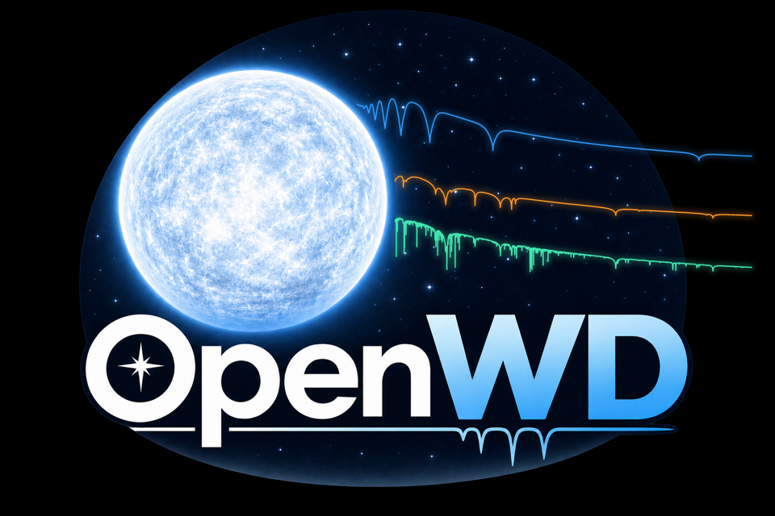
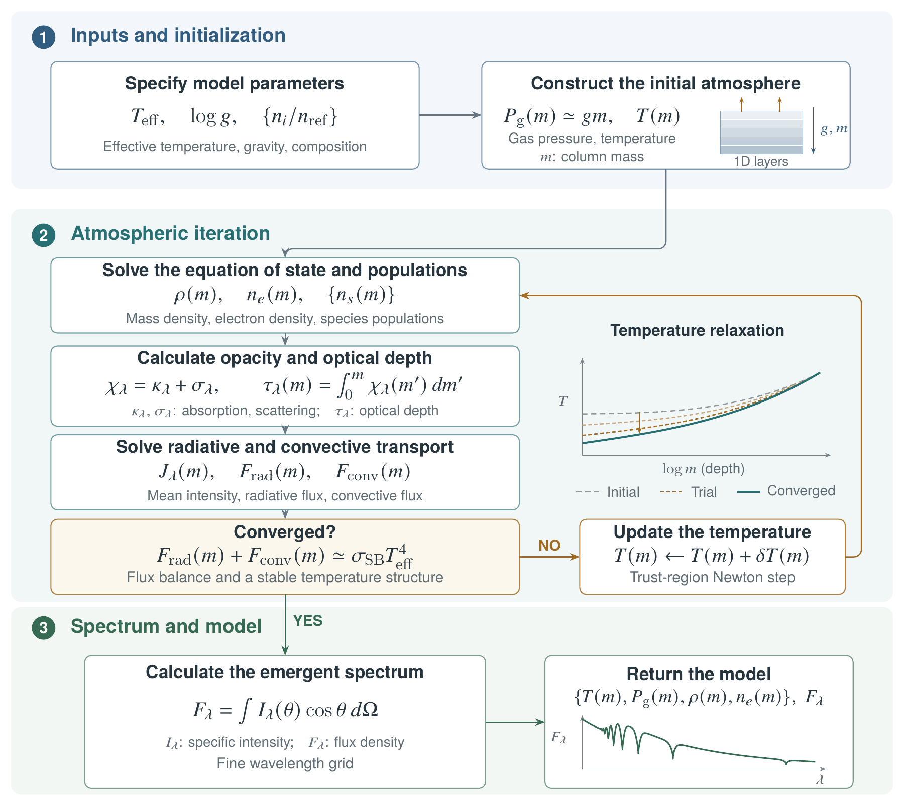

<p align="center">
  
</p>

# OpenWD

OpenWD calculates white-dwarf model atmospheres and their emergent spectra.
You give the effective temperature (Teff), the surface gravity (log g) and the
composition. OpenWD solves the atmospheric structure and the radiative
transfer from a cold start; it does not interpolate in a precomputed grid.

| Class | Atmosphere | Populations | Guide |
| --- | --- | --- | --- |
| DA | Hydrogen | LTE | [DA](docs/models/DA.md) |
| DAZ | Hydrogen with metals | LTE | [DZ/DBZ/DAZ](docs/models/DZ.md) |
| DB | Helium | LTE | [DB](docs/models/DB.md) |
| DAB/DBA | Homogeneous hydrogen–helium mixture | LTE | [DAB/DBA](docs/models/DAB.md) |
| DZ/DBZ | Helium with metals | LTE | [DZ/DBZ/DAZ](docs/models/DZ.md) |
| DQ (in development) | Helium with trace carbon and C₂ | LTE | [DQ](docs/models/DQ.md) |
| DO/DAO | Hot helium or hydrogen–helium | NLTE H and He | [DO/DAO](docs/models/DO-DAO.md) |
| PG 1159 | Hot helium–carbon–oxygen | NLTE He, C and O | [PG 1159](docs/models/PG1159.md) |
| D6 | Carbon–oxygen with heavier elements, no H or He | LTE | [D6](docs/models/D6.md) |
| DAH | Magnetic hydrogen | LTE | [DAH](docs/models/DAH.md) |
| sdB | Hot subdwarf hydrogen–helium | LTE structure, NLTE H and He | [sdB](docs/models/sdB.md) |

DQ is in development and not yet ready for broader use. Its spectra match
observations well only above about 7000 K; see the [DQ guide](docs/models/DQ.md).

## Install

Use Python 3.9 or newer:

```bash
git clone https://github.com/kareemelbadry/OpenWD.git
cd OpenWD
python -m pip install -e .
```

All classes use bundled data, with one exception: metal-free DAB/DBA models
need the HITRAN `H2-He_2011.cia` file. The
[installation guide](docs/installation.md) tells you how to get it. It also
describes the optional C extension that makes calculations faster.

## Run a model

```python
from wd_spectra import DAConfig, run_model

run = run_model(
    DAConfig(effective_temperature=12_000, logg=8.0),
    "results/my-first-da",  # must be a new directory
)
print("Converged:", run.convergence_verified)

wavelength = run.spectrum.wavelength_angstrom  # vacuum Angstrom
flux = run.spectrum.surface_flux_lambda        # surface F_lambda, erg/s/cm^2/A
continuum = run.spectrum.continuum_flux_lambda
```

The run takes several minutes. It saves the spectrum, the atmosphere and the
convergence diagnostics in the output directory. To change the class or the
composition, see [getting started](docs/getting-started.md). For an
interactive version, open the [example notebook](examples/generate_spectrum.ipynb).

## Documentation

- [Getting started](docs/getting-started.md): outputs, convergence and one
  example for each class.
- [Model guides](docs/models/README.md): physics, options and paper
  comparisons.
- [Documentation home](docs/README.md): all pages.

Read the [limitations](docs/limitations.md) and the
[tested ranges](docs/tested-temperature-ranges.md) before you use a model for
science.

To use OpenWD with an AI assistant, tell it to read [AGENTS.md](AGENTS.md).

## How it works

OpenWD couples hydrostatic equilibrium, the equation of state, LTE or NLTE
level populations, opacities, radiative transfer and ML2 convection. One
shared trust-region Newton solver finds the self-consistent structure.
`run_model` selects the physics from the configuration and the local
conditions in the atmosphere, before it solves.



## Development

```bash
python -m pip install -e '.[test]'
python -m pytest
```

See the [development guide](docs/development/README.md).

## License

OpenWD is licensed under BSD-3-Clause. The bundled scientific tables keep
their own licenses and attribution; see the
[third-party notices](THIRD_PARTY_NOTICES.md).
