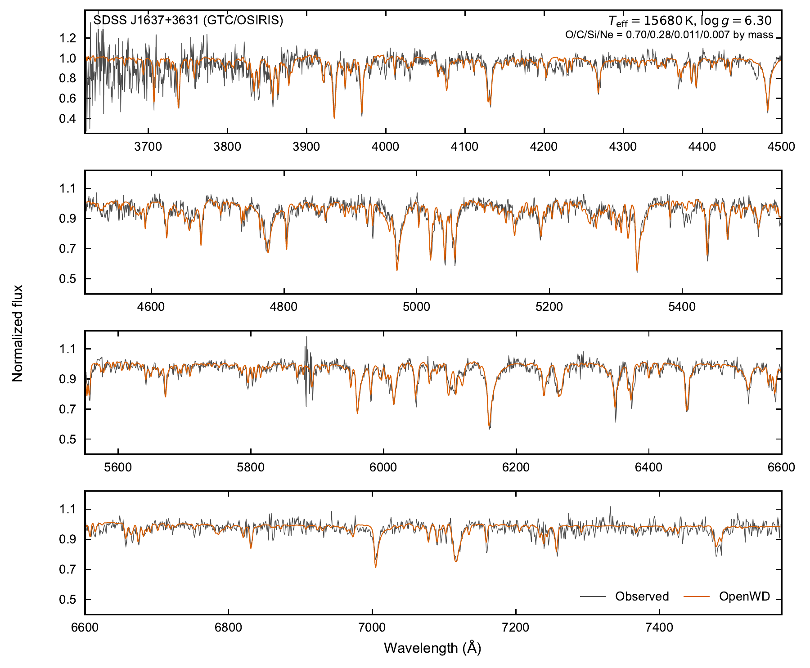

# D6: hydrogen- and helium-free atmospheres

[Model guide](README.md) · [Getting started](../getting-started.md)

`D6Config` computes warm LTE atmospheres made of carbon, oxygen and heavier
elements, with no hydrogen or helium. Such atmospheres occur in D6 stars, the
proposed survivors of double-detonation Type Ia supernovae. Every element
contributes to the pressure, the charge balance, the mass and the opacity.
The defaults are the Hollands et al. (2025) solution for SDSS J1637+3631.
OpenWD does not fit observations.

All D6 data are bundled; see [Getting started](../getting-started.md) for the
installation.

## Run a model

```python
from wd_spectra import D6Config, run_model

run = run_model(
    D6Config(
        effective_temperature=15_680, logg=6.3,
        abundances={"C": 0.0, "O": 0.27, "Ne": -1.86, "Mg": -2.33, "Al": -4.00,
                    "Si": -1.76, "S": -2.84, "Ca": -2.85, "Fe": -3.00},  # log10 N(X)/N(C)
        quality="standard",
    ),
    "results/d6-j1637",
    require_convergence=True,
)
spectrum = run.spectrum  # vacuum wavelength (Å), surface F_lambda
```

This J1637 model takes about 2–2.5 hours on one core. The default spectrum
covers 3400–7700 Å in 0.1 Å steps. Give `wavelength=` to `run_model` for a
different grid. The script `examples/one_shot_d6.py` does the same from the
command line.

## Options

| Option | Default | Effect |
| --- | --- | --- |
| `effective_temperature`, `logg` | 15680 K, 6.3 | Stellar parameters. |
| `abundances` | J1637 (Hollands et al. 2025) | log10 number ratios to `reference_element`. H and He are not allowed. |
| `reference_element` | `"C"` | Its own abundance entry must be 0. |
| `quality` | `"standard"` | `"quick"` (24 depths, 2000 lines), `"standard"` (48 depths, 25,000 lines), `"production"` (72 depths, 25,000 lines). |
| `mixing_length_alpha` | 1.25 | ML2 convection parameter. |
| `structure_maximum_metal_lines`, `formal_maximum_metal_lines` | `None` (set by `quality`) | Line budgets of the structure and the spectrum. |
| `microturbulent_velocity_kms` | 0 | Microturbulence in the structure and the spectrum. |
| `linear_stark_profile` | `"manifold"` | Quasi-static Stark profile of Rydberg lines. `"two-level"` is a simpler envelope. |
| `metal_series_pseudocontinuum_elements` | `("O", "Mg", "C")` | Elements whose dissolved Rydberg lines continue as a pseudo-continuum. |
| `line_profile_edge_optical_depth` | 1e-3 | Line wings extend until their vertical optical depth falls below this value. |

The switches `include_rydberg_dissolution`, `include_metal_series_pseudocontinuum`,
`include_linear_stark_quasistatic` and `include_oxygen_i_series_stark` are
`True` by default. Set them to `False` only for diagnostic comparisons.

## Physics

- **Equation of state.** Multi-element Saha balance with charge neutrality.
  Partition functions stop 0.1 eV below each continuum (Koester 2010).
  C, O and Ne include all ionization stages. Other elements include three.
  ML2 convection uses the derivatives of the same EOS.
- **Continuum.** Level-resolved Opacity Project cross sections (Cunto et al.
  1993), including excited levels. C I, O I, Ne I, Mg I–II, Al II, Si I–II,
  S II and Fe II come from TLUSTY (Hubeny & Lanz 2017). C II and O II come
  from TOPbase through SIROCCO (Long & Knigge 2002). Thresholds are shifted to
  experimental energies. Other ions use Verner et al. (1996) fits. Free–free
  absorption and electron scattering complete the continuum.
- **Lines.** Atomic Line List v3 (van Hoof et al. 2018) for charges 0–2. Added
  lines are the Kurucz O I 6258–6271 Å multiplet and the O I 2p³(²D°)3p → 4d,
  5s multiplets near 6094–6262 Å and 6368–6554 Å.
- **Broadening.** Voigt profiles use measured electron-impact widths where
  available and a classical estimate otherwise. Levels above the first
  ionization limit are measured from their parent limit. Mg II lines use the
  Kurucz electron widths. The O I 3p ⁵P–nd ⁵D series scales the 4d width of
  Dimitrijević & Sahal-Bréchot (2025) as n_eff⁵. Van der Waals widths use
  Unsöld (1955).
- **Rydberg lines.** High C, O and Mg lines are weighted by the Q-MHD
  occupation probabilities (Nayfonov et al. 1999). The dissolved strength
  continues the level-resolved cross section below its edge (Hummer &
  Mihalas 1988), so no opacity is lost.
- **Quasi-static Stark profiles.** At n_e = 1e15–1e16 cm⁻³, the ion field mixes
  nearly hydrogenic Rydberg levels. OpenWD diagonalizes the Stark problem in
  each n-manifold with the tabulated level energies. It averages the pattern
  over the Q-MHD microfield distribution and convolves it with the impact
  profile. The oscillator strength is conserved.
- **Structure.** The 25,000 highest-ranked lines enter both the structure and
  the spectrum. Each line is resolved on the wavelength grid. The shared
  adaptive Newton solver relaxes the atmosphere and checks all-depth flux and
  local energy balance.

## Validation against J1637

[](../assets/d6-paper.pdf)

GTC/OSIRIS spectrum of SDSS J1637+3631 (gray; Hollands et al. 2025) and the
OpenWD model (orange) at the published parameters and composition. The model
is a cold start, convolved to R = 2500. The agreement is good overall. The fit
is somewhat poorer than that of Hollands et al., who fitted the parameters.
Some O I members and C II lines are too deep. The O I troughs near 6100 Å and
6265 Å are narrower than observed.

`wd_spectra.validation.hollands_d6.hollands2025_scores(wavelength, flux)`
compares a model spectrum with a digitization of Hollands et al. Figure 1.

## Limitations

- The module is LTE and has no molecules or negative ions (C⁻, O⁻). Hot D6
  stars (Teff ≳ 30,000 K) need NLTE. Teff below 10,000 K is untested.
- The EOS uses ideal partition functions. Q-MHD dissolution applies only to
  the line opacity.
- Autoionization widths of the excited-parent O I lines are not included.
- J1637 is one tested point, not a Teff, log g or abundance grid.

See [limitations](../limitations.md) for the shared caveats.

## Tested range

See [tested points](../tested-temperature-ranges.md).
