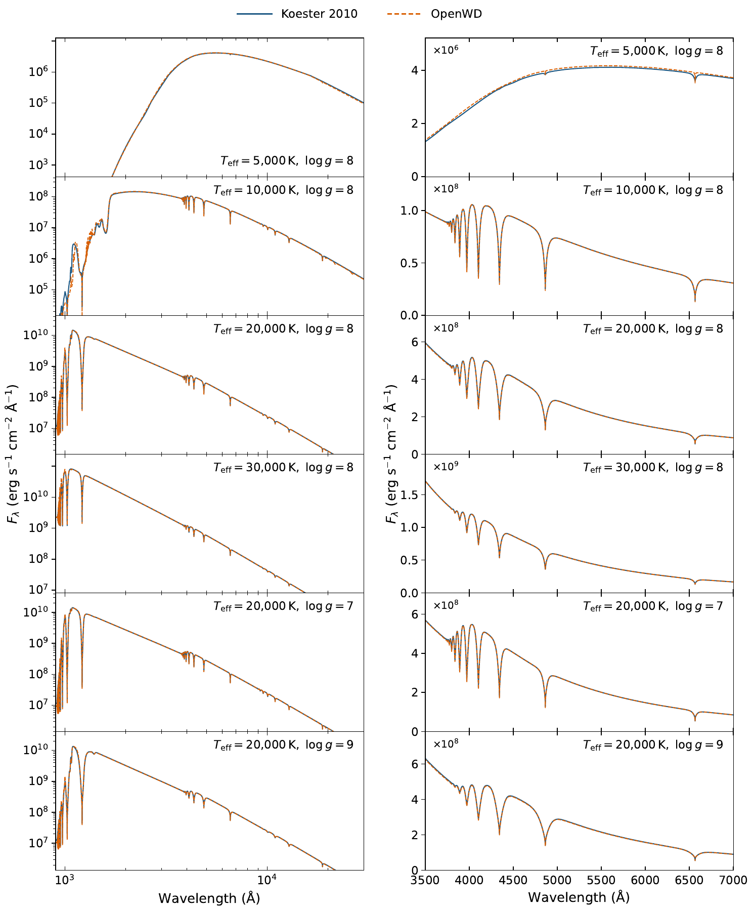
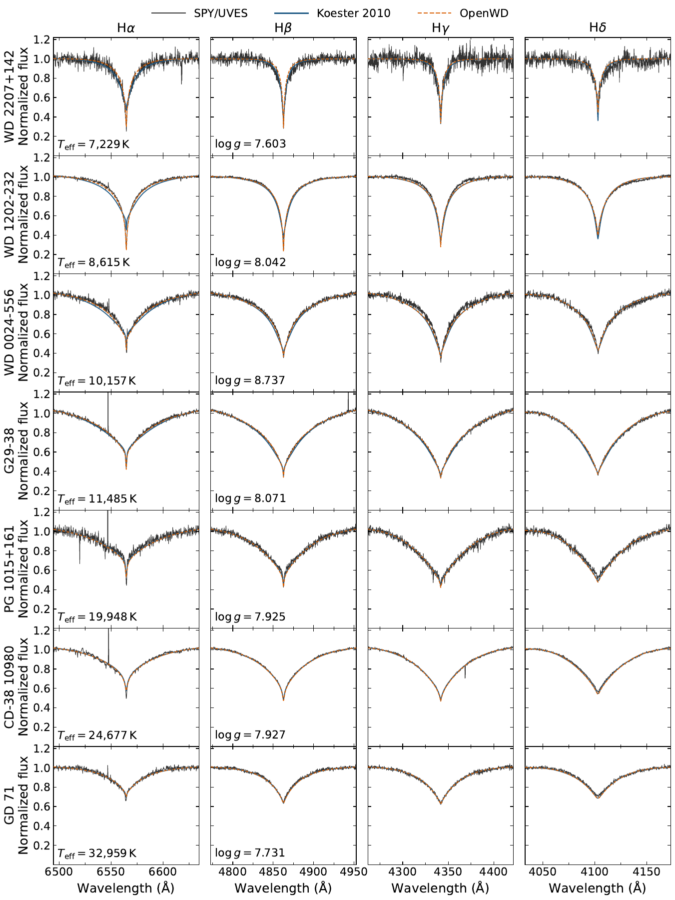
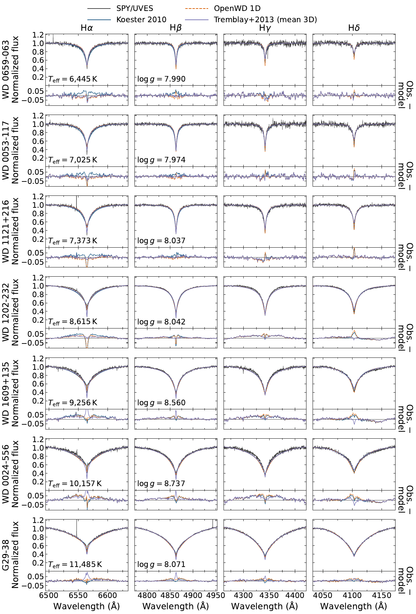
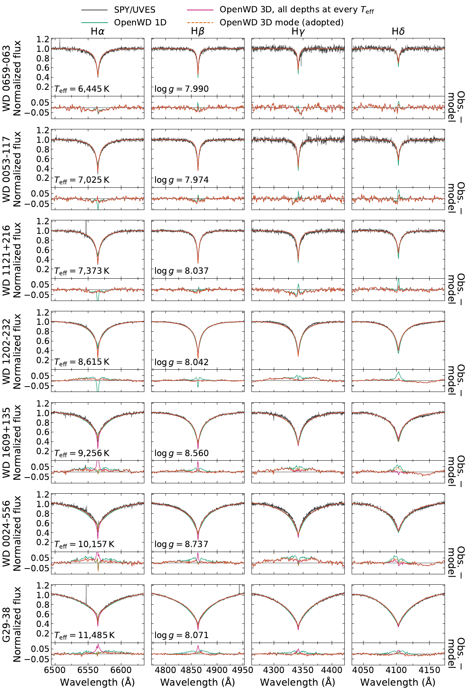

# DA: hydrogen atmospheres

[Model guide](README.md) · [Getting started](../getting-started.md)

`DAConfig` computes a homogeneous, pure-hydrogen, plane-parallel LTE
atmosphere and its emergent spectrum. The structure is in hydrostatic and
radiative/convective equilibrium, with ML2/α = 0.7 convection. Below
12,000 K the chemistry adds H₂, H₂⁺, H⁻ and H₃⁺. An optional 3D line-profile
mode corrects the Balmer profiles of cool DAs.

## Run it

```python
from wd_spectra import DAConfig, run_model

run = run_model(
    DAConfig(effective_temperature=12_000, logg=8.0, quality="production"),
    "results/da-12000",  # must be a new directory
    require_convergence=True,
)
spectrum = run.spectrum
wavelength = spectrum.wavelength_angstrom   # vacuum Angstrom
flux = spectrum.surface_flux_lambda         # erg s^-1 cm^-2 Angstrom^-1
continuum = spectrum.continuum_flux_lambda  # same structure, no lines
```

Each run is a cold start from a gray atmosphere. A production model takes
about 5–30 minutes on a laptop; cool convective models are the slowest.
The flux is at the stellar surface. The default wavelength grid spans
900–30,000 Å; pass `wavelength=` to `run_model` to change it.

| `quality` | Depth points | Use |
| --- | --- | --- |
| `"quick"` | 20 | Interface test only. Not a converged model. |
| `"standard"` | 40 | Exploration. |
| `"production"` | 100 | Science use. All paper figures use this level. |

The command-line equivalent is
`python examples/one_shot_da.py --teff 12000 --logg 8.0 --quality production --output results/da-12000`.
`compute_da(config, wavelength)` returns the same result in memory without
saving files.

## Options

| Field | Default | Meaning |
| --- | --- | --- |
| `effective_temperature` | `12000.0` | Teff in K. |
| `logg` | `8.0` | log10 of surface gravity in cm s⁻². |
| `quality` | `"standard"` | Numerical resolution (see above). |
| `mixing_length_alpha` | `0.7` | ML2 mixing length. `None` gives a radiative atmosphere. |
| `mean_3d_line_profiles` | `False` | Apply the 3D line-profile mode (see below). |
| `include_molecules` | `None` | `None` includes H₂, H₂⁺, H⁻ and H₃⁺ at Teff ≤ 12,000 K. `True` or `False` forces the choice. |
| `h2_lyman_werner_lines` | `False` | Add far-UV H₂ Lyman and Werner lines to the final spectrum (see below). |
| `lyman_profile_source` | `"allard"` | `"allard"` uses the Lyα prescription below. `"stark"` uses charged-particle Stark profiles only. |
| `allard_minimum_effective_temperature` | `9000.0` | Below this Teff, Lyα uses the cool neutral-H/H₂ wing instead of the Allard tables. |
| `balmer_self_broadening_prescription` | `None` | `None` selects Ali–Griem resonance widths. `"barklem"` selects Barklem et al. (2000). |

Other fields control numerics (`photospheric_depth_concentration`,
`synthesis_transfer_depth_refinement`, `lower_boundary_extensions`,
`convective_seed`). Keep their defaults.

## Physics

- **Structure.** Adaptive trust-region Newton solver, conservative Feautrier
  transfer, ML2/α = 0.7 convection. If a radiative model
  (`mixing_length_alpha=None`) fails on its first grid, OpenWD solves it
  again on a finer grid.
- **Equation of state.** Hummer–Mihalas occupation probabilities through
  n = 40 ([Hummer & Mihalas 1988](https://doi.org/10.1086/166600)) with
  correlated Q-MHD microfields
  ([Nayfonov et al. 1999](https://doi.org/10.1086/307972)). The neutral
  hard-sphere radius is 0.5 n² a₀
  ([Bergeron et al. 1991](https://doi.org/10.1086/169624)). There are no
  dense-fluid corrections; DA photospheres stay below about 0.03 g cm⁻³.
- **Continuum.** H I bound–free and free–free, H⁻, electron scattering and
  Rayleigh scattering. Dissolved-level opacity uses the full
  occupation-probability dissolved fraction. Below 12,000 K: H₂–H₂
  collision-induced absorption and molecular Rayleigh scattering and bands.
- **Lines.** Lyα–Ly21, Hα–H22, Paα–Pa22 and Brα–Br14. Charged-particle
  profiles from [Tremblay & Bergeron (2009)](https://doi.org/10.1088/0004-637X/696/2/1755).
  Neutral-H self broadening uses Ali–Griem resonance widths
  ([Ali & Griem 1965](https://doi.org/10.1103/PhysRev.140.A1044)) at all
  Teff.
- **Lyman α.** Below 9000 K: quasi-static H–H and H–H₂ red wing
  ([Rohrmann et al. 2011](https://doi.org/10.1111/j.1365-2966.2010.17716.x)),
  with the temperature dependence of
  [Sahu et al. (2025)](https://doi.org/10.1093/mnras/staf1907).
  From 9000 to 13,000 K: the fixed TLUSTY/SYNSPEC Allard table
  ([Hubeny & Lanz 2017](https://doi.org/10.48550/arXiv.1706.01859)).
  Above 13,000 K: temperature-dependent Allard tables for Lyα–Lyγ
  ([Allard et al. 1999](https://doi.org/10.1103/PhysRevA.60.1021)) plus half
  the charged-particle Stark profile.

### Spectrum synthesis

The final spectrum uses monotone cubic (PCHIP) source interpolation on a
4× refined depth grid. There is no flux rescaling. The output also contains
`continuum_flux_lambda`: the emergent flux of the same structure with all
bound–bound opacity removed. Dissolved-level opacity stays in the continuum,
as in TLUSTY. `spectrum.txt` stores it as the third column.

## Validation

[](../assets/da-paper-grid.pdf)

**OpenWD and the Koester (2010) grid.** Six models: 5000, 10,000, 20,000
and 30,000 K at log g = 8, and log g = 7 and 9 at 20,000 K. Left: UV–IR
surface F_λ. Right: optical spectrum. No flux scaling. The two codes agree
well. [PDF](../assets/da-paper-grid.pdf).

[](../assets/da-paper-spy.pdf)

**Seven SPY/UVES DAs, 7229–32,959 K.** Parameters are fixed at the values
of [Koester et al. (2009)](https://doi.org/10.1051/0004-6361/200912531).
OpenWD uses the 3D line-profile mode. Both models are convolved to
R = 18,500 and normalized like the data. Above about 10,000 K the codes agree
and match the data; below, OpenWD fits Hα better.
[PDF](../assets/da-paper-spy.pdf).

**Cool DAs (3000–5000 K).** OpenWD agrees with the models of
[Tremblay et al. (2011)](https://doi.org/10.1088/0004-637X/730/2/128) and the
photometry of [Blouin et al. (2018)](https://doi.org/10.3847/1538-4357/aad4a9).
At 3000 K, OpenWD is a factor of two fainter in GALEX NUV, where all models
predict very little flux. The likely cause is a different Lyα red wing.

## 3D line-profile mode (opt-in)

One-dimensional mixing-length models give Hα and Hβ cores that are too
shallow in DAs cooler than about 9000 K. Set
`DAConfig(mean_3d_line_profiles=True)` to correct this:

1. OpenWD converges the 1D atmosphere as usual.
2. It adds the mean-3D minus 1D temperature difference of
   [Tremblay et al. (2013a, Fig. 7)](https://doi.org/10.1051/0004-6361/201220813)
   on the Rosseland optical-depth scale.
3. It integrates the pressure again in hydrostatic equilibrium and computes
   the spectrum on this corrected structure.

| Condition | Correction |
| --- | --- |
| Teff < 9000 K | All depths. |
| 9000 K ≤ Teff ≤ 12,999 K | Only τ_R ≥ 10⁻² (smooth switch). |
| Teff outside 5997–12,999 K, or \|log g − 8\| > 0.75 | None. The 1D spectrum is returned. |

The switch at 9000 K is empirical. Above it, the full correction makes the
Hα and Hβ cores deeper than observed, as
[Tremblay et al. (2013b)](https://doi.org/10.1051/0004-6361/201322318) also
found. `result.atmosphere` stays the converged 1D structure.
`metadata["mean_3d_line_profiles"]` records what was applied.

**Use this mode for normalized line profiles only.** The corrected structure
is not in radiative equilibrium. The bolometric flux is 1.5–2.5% below
σTeff⁴, and the far UV is strongly suppressed at 6000–8000 K. Use the default
1D mode for spectral-energy distributions and photometry. The metadata
records `flux_conserving_spectrum = False` when the correction is applied.

[](../assets/da-paper-3d.pdf)

**Why the mode exists.** Seven SPY DAs, 6445–11,485 K, compared with the
Koester (2010) grid, OpenWD 1D and the Tremblay et al. (2013b) mean-3D
spectra. The three coolest stars use Gaia-based Montreal White Dwarf Database
parameters; the others use Koester et al. (2009). Below 9000 K the 1D Hα and
Hβ cores are too shallow. Above 9000 K the mean-3D cores are too deep.
[PDF](../assets/da-paper-3d.pdf).

[](../assets/da-paper-3d-switch.pdf)

**Effect of the 9000 K switch.** The same stars with OpenWD 1D, the 3D mode
as adopted, and the 3D mode with the correction at all depths. Below 9000 K
the two 3D versions are identical. Above 9000 K the restricted correction
keeps the wing improvement without too-deep cores.
[PDF](../assets/da-paper-3d-switch.pdf).

On 13 SPY parameter sets (6445–11,485 K), the 3D mode gives the lowest mean
rms residual of the four models compared.

## H₂ Lyman and Werner lines (opt-in)

Set `h2_lyman_werner_lines=True` to add the far-UV H₂ B–X and C–X lines seen
in cool DAs. The lines use Kurucz line lists, LTE lower levels and
fluorescent (non-LTE) source functions. They affect only the final spectrum.
The option turns on molecular chemistry at all Teff. Above 12,000 K this
changes the structure slightly. It raises an error with
`include_molecules=False`. Line data are described in
[the molecular data README](../../src/wd_spectra/data/molecular/README.md).

## Limitations

- LTE and 1D mixing-length convection. NLTE line cores of cool DAs are not
  modeled.
- The 3D mode uses the log g = 8 temperature differences only. It omits NLTE
  and 3D turbulent pressure, and it is not flux-conserving.
- Below about 4500 K, the Lyα red wing is the main uncertainty in the UV and
  blue optical.
- A high Teff does not switch to NLTE. Above about 40,000 K use
  [DAOConfig](DO-DAO.md).

See also the general [limitations](../limitations.md).

## Tested range

See [tested points](../tested-temperature-ranges.md).
