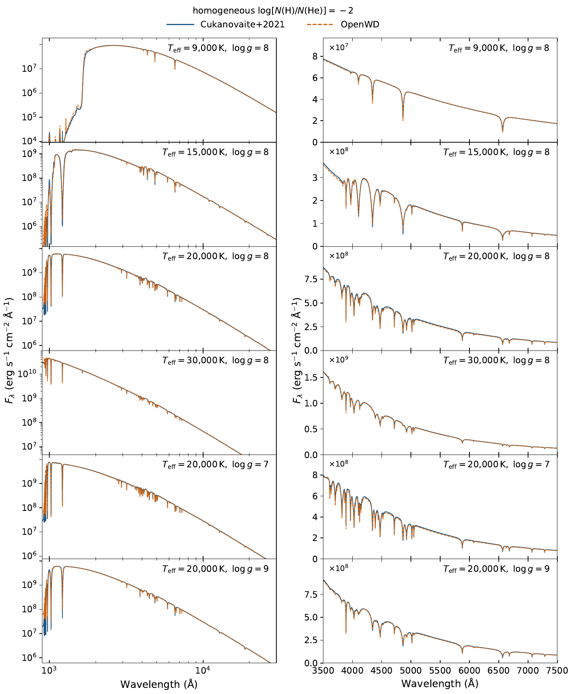

# DAB/DBA: mixed hydrogen–helium atmospheres

[Model guide](README.md) · [Getting started](../getting-started.md)

`DABConfig` computes a homogeneous hydrogen–helium LTE atmosphere for a
given Teff, log g and log10 N(H)/N(He). It is not a stratified
thin-hydrogen-layer model. "DAB" and "DBA" use the same code; the label only
says which lines are stronger. Both elements enter the EOS, opacity and
temperature structure, with ML2/α = 1.25 convection.

## Run it

```python
from wd_spectra import DABConfig, run_model

run = run_model(
    DABConfig(effective_temperature=20_000, logg=8.0,
              log_hydrogen_to_helium=-2.0, quality="production"),
    "results/dab-20000",  # must be a new directory
    require_convergence=True,
)
spectrum = run.spectrum  # surface F_lambda, vacuum Angstrom
```

`run_model` uses the molecular H/He chemistry for every metal-free DAB. This
needs the HITRAN `H2-He_2011.cia` table, which is not bundled. See
[getting started](../getting-started.md) to install it.

Each run is a cold start. A model takes about 3–20 minutes on a laptop; cool
and low-gravity models are slower.

| `quality` | Depth points | Use |
| --- | --- | --- |
| `"quick"` | 20 | Interface test only. Not a converged model. |
| `"standard"` | 40 | Exploration. |
| `"production"` | 80 | Science use. |

The command-line equivalent is
`python examples/one_shot_dab.py --teff 20000 --logg 8.0 --log-h-he -2 --quality production --output results/dab-20000`.

## Options

| Field | Default | Meaning |
| --- | --- | --- |
| `effective_temperature` | `20000.0` | Teff in K. |
| `logg` | `8.0` | log10 of surface gravity in cm s⁻². |
| `log_hydrogen_to_helium` | `-2.0` | log10 N(H)/N(He), constant with depth. |
| `quality` | `"standard"` | Numerical resolution (see above). |
| `mixing_length_alpha` | `1.25` | ML2 mixing length. |
| `include_molecules` | `False` | Molecular chemistry in `compute_dab`. `run_model` sets it to `True` for metal-free models. |
| `h2_he_cia_path` | `None` | Path to `H2-He_2011.cia`. `None` looks in the data cache. |
| `neutral_broadening` | `"unsold"` | Neutral-He broadening of He I lines (as for [DB](DB.md#options)). |
| `allard_minimum_effective_temperature` | `None` | `None` uses the Allard Lyα tables at all Teff. A number sets a Teff below which the cool neutral-H wing is used. |
| `abundances` | `None` | Trace metals (see [Trace metals](#trace-metals)). |

## Physics

- **Equation of state.** One charge-neutral solution for H I, H II, He I,
  He II and He III, with Hummer–Mihalas/Q-MHD occupation probabilities. Both
  elements enter the pressure, density, thermodynamic derivatives and
  structure.
- **Molecules** (`run_model`, metal-free). H₂, H₂⁺, H⁻ and H₃⁺ by mass
  action. The molecular terms vanish where molecules are rare, so there is no
  switch in Teff or log g.
- **Continuum.** The hydrogen and helium continua of the [DA](DA.md) and
  [DB](DB.md) modules. With molecules: H₂–H₂ and H₂–He (HITRAN, Abel et al.)
  collision-induced absorption, H₂ bands and the neutral Lyα wing.
- **Hydrogen lines.** As in the DA module: Tremblay & Bergeron (2009)
  charged-particle profiles and Ali–Griem self broadening, plus an
  approximate neutral-He impact width. Lyα uses the Allard tables at all
  Teff; the 9000 K table is used for cooler gas.
- **Helium lines.** B25 He I profiles with Unsöld broadening, and
  Schöning–Butler He II profiles, as in the DB module.

## Validation

[](../assets/dab-paper-grid.pdf)

**OpenWD and the Cukanovaite et al. (2021) DB/DBA models at
log N(H)/N(He) = −2.** Six models: 9000, 15,000, 20,000 and 30,000 K at
log g = 8, and log g = 7 and 9 at 20,000 K
([Cukanovaite et al. 2021](https://doi.org/10.1093/mnras/staa3684)). Left:
900–30,000 Å surface flux. Right: optical hydrogen and helium lines. No flux
scaling. Agreement is good over the full range.
[PDF](../assets/dab-paper-grid.pdf).

## Trace metals

`DABConfig(abundances={...})` adds trace metals to the atomic H/He
atmosphere. Abundances are **log10 N(Z)/N(H)**, as for DAZ. The host can be
hydrogen-rich (DABZ, DAZB) or helium-rich (DBAZ).

- Metals share the H/He charge balance. They add bound–bound and bound–free
  opacity to the structure (opacity-sampled at R = 1000) and to the final
  spectrum. They do not enter the EOS thermodynamics.
- `maximum_metal_charge` (default `4`) is one value or a mapping by element.
- `metal_classical_electron_stark=True` adds the SYNSPEC classical electron
  width to metal lines without a tabulated Stark width.
- `metal_line_supplements` adds optional E1 lines for ions whose Stout data
  contain only forbidden lines: `"rauch-zn-cu"` (Rauch et al., Zn IV–V,
  Cu IV–VI) and `"kurucz-fe-ni"` (Kurucz Fe IV, Fe VII, Ni IV–VI). The
  default `()` uses Stout only.
- Metals and molecules cannot be combined. `run_model` refuses a metal-bearing
  DAB where molecular chemistry matters.

For helium-dominated stars with very little hydrogen, use [DZ](DZ.md). With
metals, the Rosseland depth scale includes the metal opacity, so compare
structures on column mass. The [niobium note](../development/niobium.md)
shows a nine-metal application.

## Limitations

- No unified H–He Lyman and Balmer profiles.
- Homogeneous composition only; no stratified hydrogen layer.
- The molecular chemistry is ideal-gas mass action, not a dense-fluid EOS.

See also the general [limitations](../limitations.md).

## Tested range

See [tested points](../tested-temperature-ranges.md).
