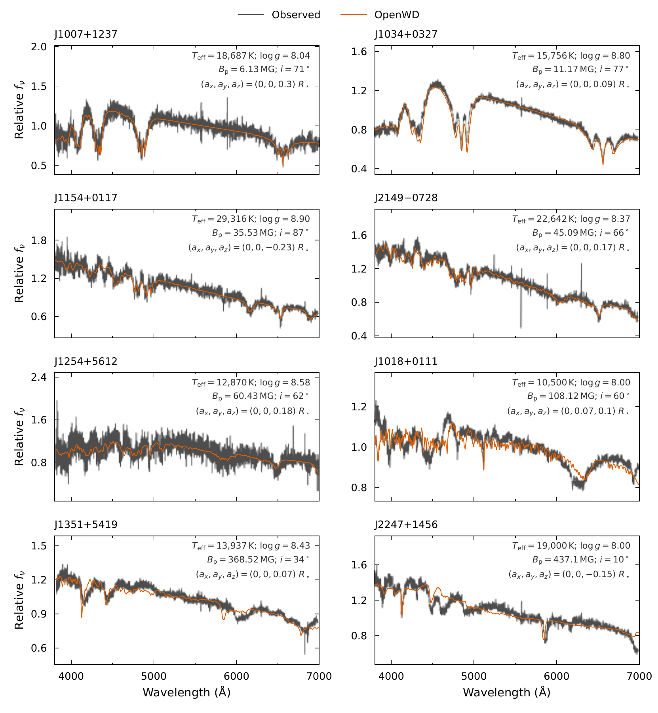
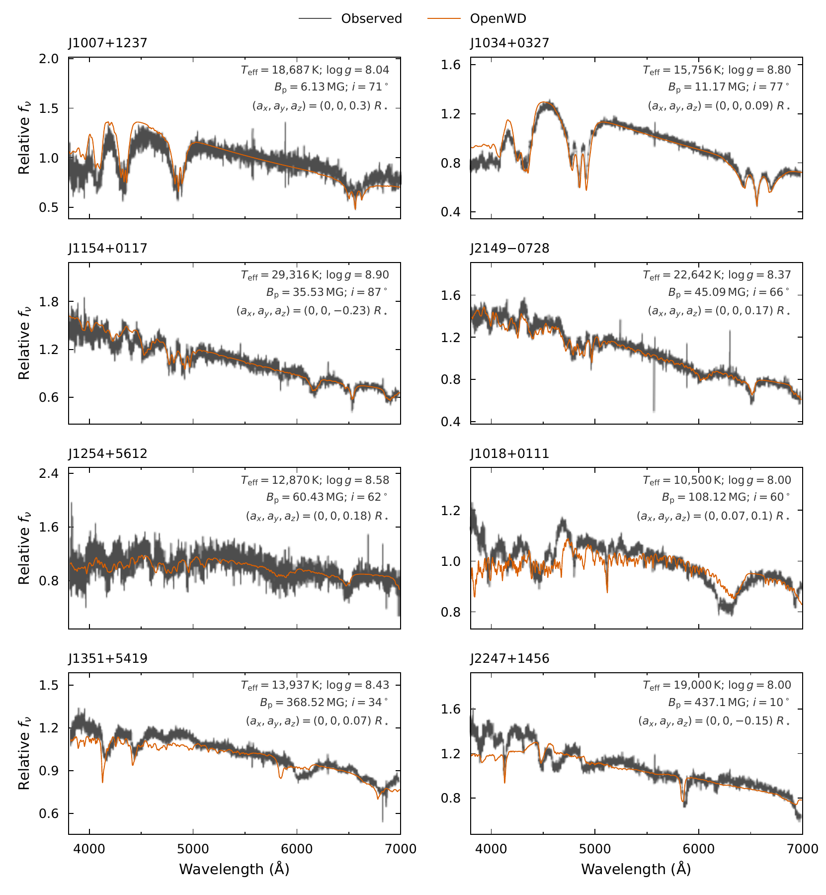

# DAH: magnetic hydrogen atmospheres

[Model guide](README.md) · [Getting started](../getting-started.md)

`DAHConfig` predicts the disk-integrated optical spectrum of a magnetic,
pure-hydrogen white dwarf. The field is uniform or an offset dipole. OpenWD
computes the spectrum on a nonmagnetic DA atmosphere at the same Teff and
log g. Each surface element has its own field strength and direction, and
the emergent intensities are summed over the visible disk.

## Run it

This example uses the published parameters of J1007+1237
([Hardy et al. 2023](https://doi.org/10.1093/mnras/stad196)):

```python
import numpy as np
from wd_spectra import DAHConfig, run_model

config = DAHConfig(
    effective_temperature=18_687, logg=8.04,
    magnetic_field_megagauss=6.13,       # polar field of the undisplaced dipole
    field_geometry="dipole", dipole_inclination_deg=71,
    dipole_offset_radius=(0.0, 0.0, 0.30),
    quality="production",
)
run = run_model(
    config, "results/j1007",  # must be a new directory
    wavelength=np.arange(3600.0, 7100.01, 0.5),
    require_convergence=True,
)
spectrum = run.spectrum  # surface F_lambda, vacuum Angstrom
```

A model takes a few minutes on a laptop. Wavelengths must lie in
3400–8000 Å. The output is surface F_λ in erg s⁻¹ cm⁻² Å⁻¹.

| `quality` | Depth points | Use |
| --- | --- | --- |
| `"quick"` | 20 | Interface test only. Not a converged model. |
| `"standard"` | 40 | Exploration. |
| `"production"` | 100 | Science use. Used for the paper figure. |

The command-line equivalent is:

```sh
python examples/one_shot_dah.py --teff 18687 --logg 8.04 \
    --field-mg 6.13 --geometry dipole --inclination 71 --offset 0 0 0.30 \
    --quality production --require-convergence --output results/j1007-cli
```

`examples/dah_paper.py` runs any of the eight paper objects at fixed
parameters. Add `--prescription default` to reproduce the paper figure.
Without it, the script uses `paper_dah_config` (see
[Other physics options](#other-physics-options)).

## Options

| Field | Default | Meaning |
| --- | --- | --- |
| `effective_temperature` | `16700.0` | Teff in K; accepted range 5000–40,000 K. |
| `logg` | `8.07` | log10 of surface gravity in cm s⁻²; accepted range 7.0–9.5. |
| `magnetic_field_megagauss` | `0.325` | Uniform field strength, or the polar field of the undisplaced dipole. |
| `field_geometry` | `"uniform"` | `"uniform"` or `"dipole"`. |
| `field_angle_deg` | `None` | Uniform field only. `None` averages over isotropic directions; a number fixes the angle to the line of sight. |
| `field_strength_definition` | `"dipole-polar"` | `"visible-mean"` normalizes a dipole to its projected-area mean field instead. |
| `dipole_inclination_deg` | `60.0` | Angle between the dipole axis and the line of sight. |
| `dipole_offset_radius` | `(0, 0, 0)` | Dipole displacement (a_x, a_y, a_z) in stellar radii; z along the dipole axis, line of sight in the x–z plane. |
| `quality` | `"standard"` | Numerical resolution (see above). |
| `disk_field_bins` | `21` | Number of field bins for the disk sum. `None` keeps every surface cell. |
| `disk_component_drift_angstrom` | `None` | Builds dipole field bins from a limit on component wavelength drift. Use about 16 Å at high fields. Slower. See the [quadrature note](../development/history/dah-disk-quadrature-2026-10-08.md). |
| `polarized_transfer` | `"scalar-stokes-i"` | `"full-stokes-iquv"` solves full polarized transfer. |
| `return_stokes` | `False` | Return Q, U and V (see [Polarized output](#polarized-output)). |
| `mixing_length_alpha` | `None` | `None`: ML2/α = 0.7 below a mean visible field of 0.05 MG, radiative above. A number forces ML2 with that α. |

## Physics

- **Structure.** A nonmagnetic DA atmosphere from the shared Newton solver,
  with the DA opacities. Convection is off when the mean visible field
  exceeds 0.05 MG ([Tremblay et al. 2015](https://doi.org/10.1088/0004-637X/812/1/19);
  [Gentile Fusillo et al. 2018](https://doi.org/10.1093/mnras/stx2584)).
  The convergence certificate applies to this nonmagnetic structure.
- **Line components.** Below 1 MG, Hα–H22 split into normal Zeeman triplets.
  Above 1 MG, Hα–H12 use the wavelengths and strengths of the H2db database
  ([Schimeczek & Wunner 2014](https://doi.org/10.1016/j.cpc.2013.09.023);
  [H2db data](https://doi.org/10.18419/DARUS-2118)). π components absorb in
  proportion to sin²ψ and σ± components to (1 + cos²ψ)/2, where ψ is the
  angle between the field and the ray.
- **Line profiles.** Each component has the Kurucz/Griem Stark profile
  ([Kurucz 1970](https://articles.adsabs.harvard.edu/pdf/1970SAOSR.309.....K)),
  as in [Moss et al. (2024)](https://doi.org/10.1093/mnras/stad3825). The
  component strengths are normalized so that their sum equals the zero-field
  line strength.
- **Continuum and EOS above 1 MG.** Each surface element solves a magnetic
  Saha/Hummer–Mihalas equilibrium on the fixed temperature–pressure
  structure. It includes Landau-quantized free charges, field-dependent bound
  energies and centred-motion transverse masses. H I bound–free opacity for
  n = 1–8 uses rigid-wavefunction (RWA) photoionization cross sections
  ([Rohrmann 2026](https://doi.org/10.1051/0004-6361/202658917)). At or below
  1 MG the zero-field EOS and continuum apply. Cyclotron absorption is off.
- **Transfer.** Scalar Stokes I by default, with the angle-weighted π and σ±
  opacities. Full IQUV transfer is optional.

## Results at published parameters

The eight objects below have fixed published parameters, ordered by polar
field. J1018+0111 and J2247+1456 are from
[Vera-Rueda & Rohrmann (2024)](https://doi.org/10.1051/0004-6361/202449627);
the others are from [Hardy et al. (2023)](https://doi.org/10.1093/mnras/stad196).

| Object | Teff (K) | log g | B_p (MG) | i (deg) | (a_x, a_y, a_z) |
| --- | ---: | ---: | ---: | ---: | --- |
| J1007+1237 | 18687 | 8.04 | 6.13 | 71 | (0, 0, 0.30) |
| J1034+0327 | 15756 | 8.80 | 11.17 | 77 | (0, 0, 0.09) |
| J1154+0117 | 29316 | 8.90 | 35.53 | 87 | (0, 0, −0.23) |
| J2149−0728 | 22642 | 8.37 | 45.09 | 66 | (0, 0, 0.17) |
| J1254+5612 | 12870 | 8.58 | 60.43 | 62 | (0, 0, 0.18) |
| J1018+0111 | 10500 | 8.00 | 108.12 | 60 | (0, 0.07, 0.10) |
| J1351+5419 | 13937 | 8.43 | 368.52 | 34 | (0, 0, 0.07) |
| J2247+1456 | 19000 | 8.00 | 437.10 | 10 | (0, 0, −0.15) |

[](../assets/dah-paper-rescaled.pdf)

**Eight DAHs, paper version.** Observed SDSS spectra and OpenWD predictions
(default physics), in relative f_ν. Models are convolved to the instrumental
resolution and scaled to the data over 5200–6100 Å. A low-order polynomial
fitted to the observed/model ratio absorbs flux-calibration and reddening
errors. The J1034+0327 spectrum is first recalibrated to SDSS and Pan-STARRS
photometry. Agreement is good below about 100 MG and worse above.
[PDF](../assets/dah-paper-rescaled.pdf).

[](../assets/dah-paper-unscaled.pdf)

**The same comparison with one flux scale per object** and no polynomial
correction. Use this version to judge the continuum.
[PDF](../assets/dah-paper-unscaled.pdf).

Fixed-state checks compare the public default on all eight stars and the
paper prescription on three representative stars with the
[current regression controls](../../tests/data/approved_regressions/README.md).
Separate J1007 and J1254 cold canaries calculate new atmospheres and require
the equilibrium checks and absolute-flux agreement.

## Other physics options

| Field | Default | Meaning |
| --- | --- | --- |
| `include_rwa_photoionization` | `True` | RWA bound–free opacity above 1 MG. |
| `include_magnetic_eos` | `True` | Magnetic Saha/HM equilibrium above 1 MG. |
| `include_centered_motion` | `True` | Transverse-mass weighting in the EOS and RWA populations. |
| `include_cyclotron_absorption` | `False` | Magneto-ionic free–free and Thomson opacity with a cyclotron resonance. |
| `balmer_profile` | `"kurucz-griem"` | `"unified"` uses the zero-field DA Stark and neutral-broadening profiles. |
| `normalize_balmer_strength` | `True` | `False` keeps the field-dependent H2db total line strength. |
| `atmosphere_structure` | `"nonmagnetic"` | `"mean-field"` solves one structure at the mean visible field with magnetic opacities above 1 MG. |

`paper_dah_config(**parameters)` returns a `DAHConfig` with the zero-field
EOS and H I bound–free opacity at all fields (`include_rwa_photoionization`,
`include_magnetic_eos` and `include_centered_motion` all `False`). It
accepts stellar, geometry, transfer and numerical inputs and refuses
changes to these physics switches. `DAH_PAPER_PRESCRIPTION` lists them.

## Polarized output

Set `polarized_transfer="full-stokes-iquv"` and `return_stokes=True`. A
dipole also needs `disk_field_bins=None`.

```python
from wd_spectra import DAHConfig, run_model

config = DAHConfig(
    effective_temperature=15_000, logg=8.0, magnetic_field_megagauss=0.5,
    field_geometry="dipole", dipole_inclination_deg=60, disk_field_bins=None,
    polarized_transfer="full-stokes-iquv", return_stokes=True,
    sky_position_angle_deg=30,
)
run = run_model(config, "results/dah-stokes", require_convergence=True)
s = run.spectrum  # StokesSpectrum
i, q, u, v = (s.surface_flux_lambda, s.surface_flux_q_lambda,
              s.surface_flux_u_lambda, s.surface_flux_v_lambda)
```

- All four arrays are disk-integrated surface fluxes. Form Q/I, U/I and V/I
  from these sums. `run_model` also saves `stokes.txt`.
- The output uses the optical convention of
  [Landi Degl'Innocenti, Bagnulo & Fossati (2007)](https://arxiv.org/abs/astro-ph/0610262).
  For the IAU convention with the same sky axes, use `v_iau = -v`.
- `sky_position_angle_deg` rotates the field map counterclockwise from the
  sky x-axis. Rotation phases and Doppler shifts are not modeled.
- `wd_spectra.validation.magnetic_da.score_dah_circular_polarization`
  compares an observed V/I with a returned spectrum.
- Q, U and V are not validated against polarimetry. The metadata records
  `polarimetry_validated=False`.

### Custom surface maps

Pass `surface_cells=` to `compute_dah` to use your own field map (for
example a multipole at one rotation phase). Build it with
`wd_spectra.magnetic.SurfaceCells`, or with `dipole_surface_cells` and
`uniform_field_surface_cells`. The map replaces the built-in geometry. Its
maximum field selects the atomic data, and its mean field controls
convection. Temperature, gravity, quality and physics options still come
from `DAHConfig`.

## Limitations

- Accuracy degrades above about 100 MG. At high fields, stationary
  components dominate, and their shapes need a joint Stark–Zeeman treatment
  that the per-component Kurucz/Griem profiles do not provide.
- The RWA bound–free opacity is tested against quantum cross sections only
  up to about 200 MG. Above 200 MG of visible field, the continuum is
  uncertain; the metadata records a `domain_notes` entry.
- The atmosphere structure is nonmagnetic. Magnetic Lyman, Paschen and
  Brackett lines, H13 and higher above 1 MG, and strong-field molecules are
  absent.
- The accepted range (5000–40,000 K, log g 7–9.5) is wider than the tested
  sample.

See also the general [limitations](../limitations.md). Data attribution is in
the [third-party notices](../../THIRD_PARTY_NOTICES.md).

## Tested range

See [tested points](../tested-temperature-ranges.md).
