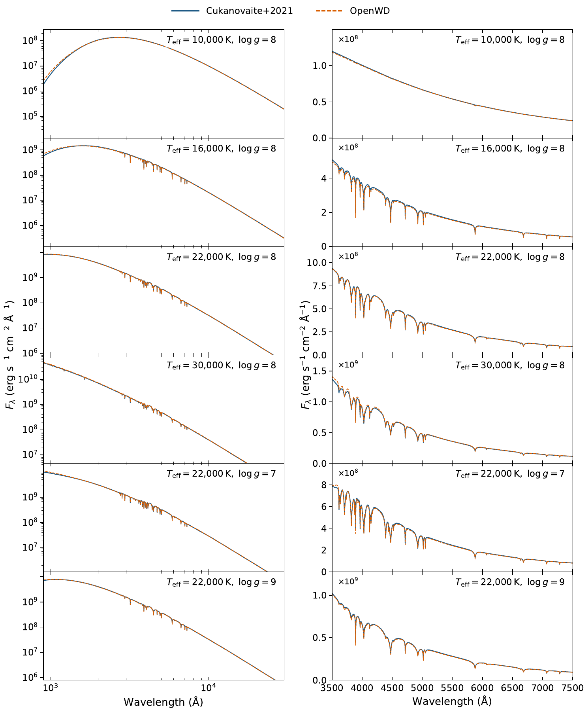
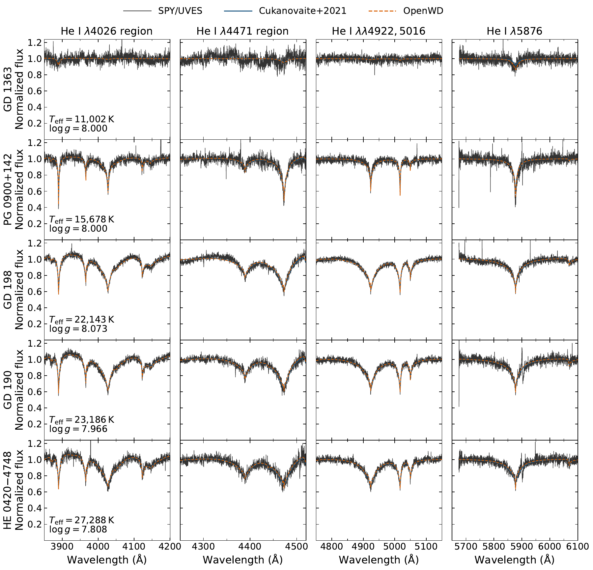
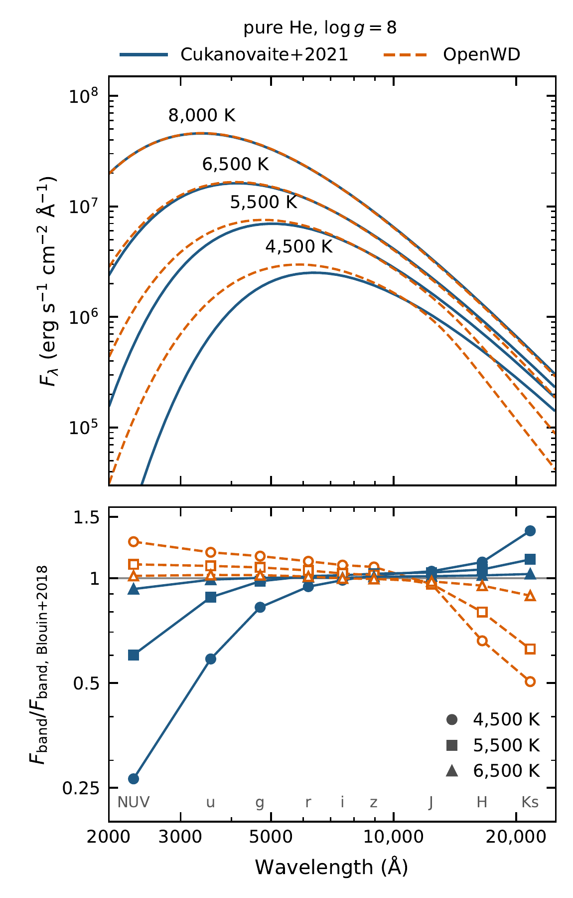

# DB: helium atmospheres

[Model guide](README.md) · [Getting started](../getting-started.md)

`DBConfig` computes a homogeneous, pure-helium, plane-parallel LTE
atmosphere and its emergent spectrum, with ML2/α = 1.25 convection.
`run_model` selects one of two treatments. Warm DBs use a dilute-gas helium
EOS. Cool DBs, where the photosphere is dense and neutral, use a dense-helium
treatment.

## Run it

```python
from wd_spectra import DBConfig, run_model

run = run_model(
    DBConfig(effective_temperature=20_000, logg=8.0, quality="production"),
    "results/db-20000",  # must be a new directory
    require_convergence=True,
)
print(run.selection.workflow)  # "db" (warm) or "dense-db" (cool)
spectrum = run.spectrum         # surface F_lambda, vacuum Angstrom
```

Each run is a cold start. A warm model takes about 3–30 minutes on a laptop.
A dense-helium model takes about 10–15 minutes.

| `quality` | Depth points | Use |
| --- | --- | --- |
| `"quick"` | 20 | Interface test only. Not a converged model. |
| `"standard"` | 40 | Exploration (warm DBs only). |
| `"production"` | 80 | Science use. Required for dense helium. |

The command-line equivalent is
`python examples/one_shot_db.py --teff 20000 --logg 8.0 --quality production --output results/db-20000`.

## Options

| Field | Default | Meaning |
| --- | --- | --- |
| `effective_temperature` | `20000.0` | Teff in K. Dense helium requires an integer value. |
| `logg` | `8.0` | log10 of surface gravity in cm s⁻². |
| `quality` | `"standard"` | Numerical resolution (see above). |
| `mixing_length_alpha` | `1.25` | ML2 mixing length. |
| `transfer_discretization` | `"auto"` | `"auto"` uses column-mass cells where He⁻ free–free dominates the outer-layer opacity, and optical-depth cells elsewhere. `"column-mass"` and `"optical-depth"` force one. |
| `photospheric_depth_concentration` | `1.0` | Concentrates depth points across 0.01 < τ < 10. |

If a production model fails its stationarity check, try
`photospheric_depth_concentration=2`. This fixed the model at 27,000 K and
log g = 9.25.

## Physics

### Warm DBs

- **Structure.** Adaptive trust-region Newton solver, as for DA, with
  ML2/α = 1.25 ([Beauchamp et al. 1999](https://doi.org/10.1086/307148);
  [Bergeron et al. 2011](https://doi.org/10.1088/0004-637X/737/1/28)).
- **Equation of state.** He I, He II and He III ionization with charge
  neutrality. Hummer–Mihalas occupation probabilities through n = 40 with
  correlated Q-MHD microfields. The neutral hard-sphere radius is
  0.5 n_eff² a₀ / Z, as for hydrogen.
- **Continuum.** He I and He II bound–free, He II/He III and He⁻ free–free,
  the He–He⁺ continuum and dissolved-level opacity. Electron and Rayleigh
  scattering. He⁻ free–free from
  [John (1994)](https://doi.org/10.1093/mnras/269.4.871) inside its table,
  and from the John & Seaton / Carbon & Gingerich fit outside it.
- **He I lines.** 36 optical transitions with the corrected, normalized,
  Doppler-convolved "B25" profiles of
  [Tremblay et al. (2026)](https://doi.org/10.3847/1538-4357/ae5e72), which
  update [Beauchamp et al. (1997)](https://doi.org/10.1086/312961). Unsöld
  (1955) van der Waals broadening. The He I resonance series is included in
  the blanketing.
- **He II lines.** Schöning–Butler tables from SYNSPEC, and hydrogenic
  profiles for other members.

## Cool helium

`run_model` evaluates a gray photosphere at Rosseland optical depth 2/3
before it solves the model. If that photosphere is neutral (electron fraction
below 10⁻³) and the dense EOS changes its density by at least 5%, it selects
the dense-helium workflow (`"dense-db"`). At log g = 8 the switch is near
8500 K. At higher gravity it moves to higher Teff.

```python
from wd_spectra import DBConfig, run_model

run = run_model(
    DBConfig(effective_temperature=5000, logg=8.0, quality="production"),
    "results/db-5000",
    require_convergence=True,
)
print(run.selection.workflow)  # "dense-db"
```

The dense workflow runs in a separate single-threaded process. It uses its
own output wavelength grid; do not pass `wavelength=`. `compute_db` keeps the
dilute physics. It raises `DenseHeliumPhotosphereError` for a dense
photosphere.

The dense-helium physics:

- **EOS.** Bulk density and internal energy from He-REOS.3
  ([Becker et al. 2014](https://doi.org/10.1088/0067-0049/215/2/21)).
- **Trace ionization.** He⁺ and free electrons with non-ideal chemical
  potentials from integral-equation fluid calculations. Ions are divided
  between bound He₂⁺ and free He⁺.
- **Continuum.** Dense-fluid correction to He⁻ free–free absorption.
  He₂⁺ bound–free and He–He⁺ free–free absorption
  ([Stancil 1994](https://doi.org/10.1086/174411)). He–He–He
  collision-induced absorption
  ([Kowalski 2014](https://doi.org/10.1051/0004-6361/201424242)). Rayleigh
  scattering with the fluid structure factor. No refraction.

Details are in the
[dense-db development note](../development/history/dense-db-v6-2026-10-22.md).

## Validation

[](../assets/db-paper-grid.pdf)

**OpenWD and the Cukanovaite et al. (2021) grid.** Six models: 10,000,
16,000, 22,000 and 30,000 K at log g = 8, and log g = 7 and 9 at 22,000 K.
The grid is 1D ML2/α = 1.25
([Cukanovaite et al. 2021](https://doi.org/10.1093/mnras/staa3684)). Left:
900–30,000 Å surface flux. Right: optical He I lines. No flux scaling.
[PDF](../assets/db-paper-grid.pdf).

[](../assets/db-paper-spy.pdf)

**Five SPY/UVES DBs, 11,002–27,288 K.** Parameters are fixed at the values
of [Voss et al. (2007)](https://doi.org/10.1051/0004-6361:20077285). Both
models are convolved to R = 18,500 and normalized like the data. Both fit
well; most residuals come from the normalization.
[PDF](../assets/db-paper-spy.pdf).

[](../assets/db-cool-paper.pdf)

**Cool DBs at log g = 8.** Top: spectral-energy distributions from OpenWD and
Cukanovaite et al. (2021). Bottom: band-averaged flux of each model relative
to the dense-fluid photometry of
[Blouin et al. (2018)](https://doi.org/10.3847/1538-4357/aad4a9).
[PDF](../assets/db-cool-paper.pdf).

- Down to about 6500 K, OpenWD agrees with Cukanovaite et al. to a few per
  cent between 3000 Å and 1.2 µm.
- At lower Teff, OpenWD agrees better with Blouin et al. in the UV and
  optical: within 0.15 mag in GALEX NUV and SDSS u at 5000 K.
- In H and Ks, OpenWD is 0.4 and 0.7 mag fainter than Blouin et al. at
  5000 K. The cause is the strength of pressure ionization. With the
  [Kowalski et al. (2007)](https://doi.org/10.1103/PhysRevB.76.075112)
  ionization, OpenWD reproduces Blouin et al. to 0.1 mag.

## Limitations

- LTE and 1D mixing-length convection. Above about 40,000 K, NLTE matters;
  use [DOConfig](DO-DAO.md).
- The dense-helium treatment is experimental. Its pressure ionization and
  dense opacities are untested by observations at these densities.

See also the general [limitations](../limitations.md).

## Tested range

See [tested points](../tested-temperature-ranges.md).
