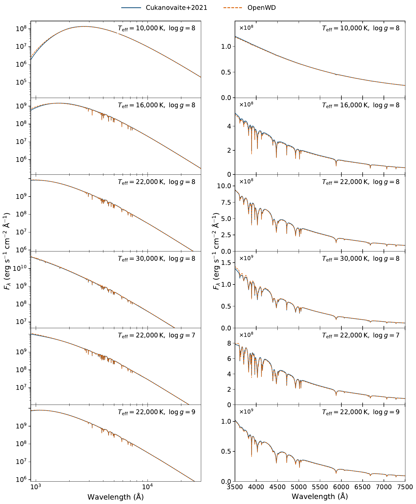
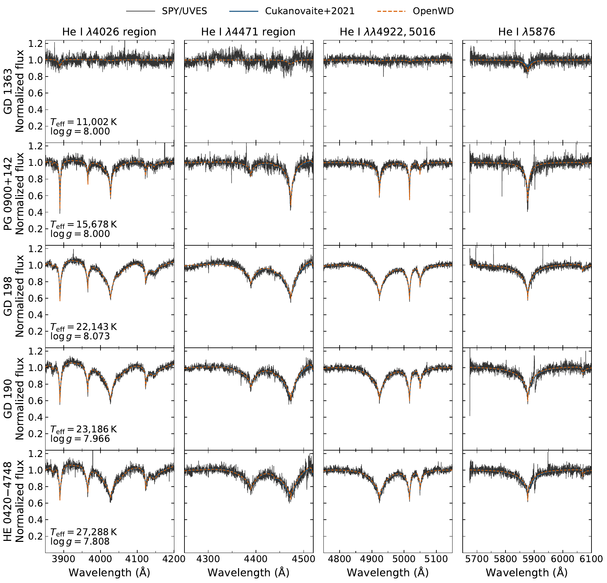
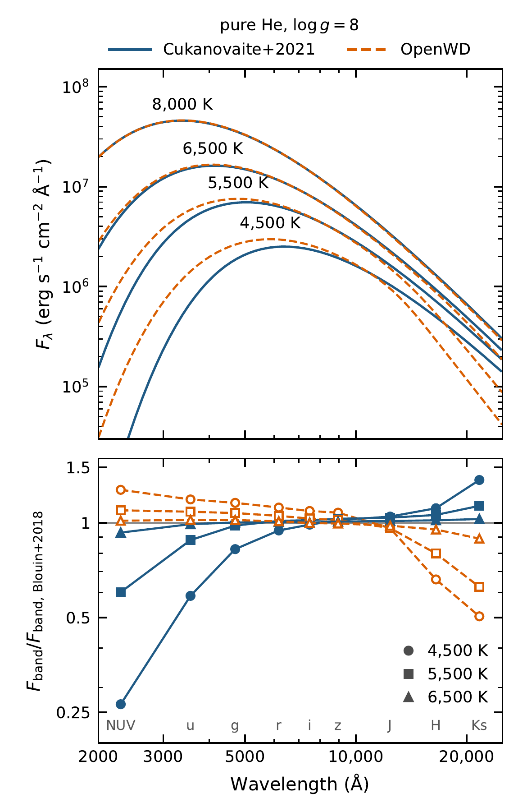

# DB: helium atmospheres

[Model guide](README.md) · [Getting started](../getting-started.md)

`DBConfig` computes a homogeneous, pure-helium, plane-parallel LTE
atmosphere and its emergent spectrum, with ML2/α = 1.25 convection.
`run_model` selects one of two treatments. Warm DBs use a dilute-gas helium
EOS. Cool DBs, where the photosphere is dense and neutral, use a dense-helium
treatment.

## Run it

```python
from wd_spectra import DBConfig, run_model

run = run_model(
    DBConfig(effective_temperature=20_000, logg=8.0, quality="production"),
    "results/db-20000",  # must be a new directory
    require_convergence=True,
)
print(run.selection.workflow)  # "db" (warm) or "dense-db" (cool)
spectrum = run.spectrum         # surface F_lambda, vacuum Angstrom
```

Each run is a cold start. A warm model takes about 3–30 minutes on a laptop.
A dense-helium model takes about 10–15 minutes.

| `quality` | Depth points | Use |
| --- | --- | --- |
| `"quick"` | 20 | Interface test only. Not a converged model. |
| `"standard"` | 40 | Exploration (warm DBs only). |
| `"production"` | 80 | Science use. Required for dense helium. |

The command-line equivalent is
`python examples/one_shot_db.py --teff 20000 --logg 8.0 --quality production --output results/db-20000`.

## Options

| Field | Default | Meaning |
| --- | --- | --- |
| `effective_temperature` | `20000.0` | Teff in K. Dense helium requires an integer value. |
| `logg` | `8.0` | log10 of surface gravity in cm s⁻². |
| `quality` | `"standard"` | Numerical resolution (see above). |
| `mixing_length_alpha` | `1.25` | ML2 mixing length. |
| `transfer_discretization` | `"auto"` | `"auto"` uses column-mass cells where He⁻ free–free dominates the outer-layer opacity, and optical-depth cells elsewhere. `"column-mass"` and `"optical-depth"` force one. |
| `photospheric_depth_concentration` | `1.0` | Concentrates depth points across 0.01 < τ < 10. |

If a production model fails its stationarity check, try
`photospheric_depth_concentration=2`. This fixed the model at 27,000 K and
log g = 9.25.

With column-mass cells the depth points are fixed in column mass. They start
at the gray seed's Rosseland depths, which put too many of them below the
photosphere of a cool DB once the He⁻ free–free opacity has relaxed. After the
lower boundary is settled, the solver moves the points onto the intended
Rosseland-depth distribution of the relaxed model and solves again, until no
point is more than half an interval from its target. At 7500 K and log g = 6
this gives 28 points across 0.01 < τ < 10 instead of 13; the bolometric
flux of the spectrum falls from 1.018 to 1.0025 σT⁴ (refinement 4) and
agrees with depth refinement 1 to 0.2%. The UV and optical flux drop by
3.7% and 1.5%. These cool models take about 50% longer.

## Physics

### Warm DBs

- **Structure.** Adaptive trust-region Newton solver, as for DA, with
  ML2/α = 1.25 ([Beauchamp et al. 1999](https://doi.org/10.1086/307148);
  [Bergeron et al. 2011](https://doi.org/10.1088/0004-637X/737/1/28)).
- **Equation of state.** He I, He II and He III ionization with charge
  neutrality. Hummer–Mihalas occupation probabilities through n = 40 with
  correlated Q-MHD microfields. The neutral hard-sphere radius is
  0.5 n_eff² a₀ / Z, as for hydrogen.
- **Continuum.** He I and He II bound–free, He II/He III and He⁻ free–free,
  the He–He⁺ continuum and dissolved-level opacity. Electron and Rayleigh
  scattering. He⁻ free–free from
  [John (1994)](https://doi.org/10.1093/mnras/269.4.871) inside its table
  (λ ≥ 5063 Å, 1400–10,080 K). Below 5063 Å at those temperatures, John's
  edge value times the wavelength shape of the Carbon et al. (1969) fit to
  John (1968), so the opacity has no step at the table edge. At higher
  temperatures, the Carbon et al. fit itself.
- **He I lines.** 36 optical transitions with the corrected, normalized,
  Doppler-convolved "B25" profiles of
  [Tremblay et al. (2026)](https://doi.org/10.3847/1538-4357/ae5e72), which
  update [Beauchamp et al. (1997)](https://doi.org/10.1086/312961). Unsöld
  (1955) van der Waals broadening. The He I resonance series is included in
  the blanketing.
- **Infrared He I lines.** 31 lines redward of the tables (8361 Å–7.4 µm):
  He I 10830 and 20581 and the lines from the n = 3 terms (12528, 12785/90,
  17002, 18686/97, 19089, 21120/32 Å and others). NIST ASD wavelengths and
  oscillator strengths, Voigt profiles with the electron (and, for 10830,
  20581 and 21120, He⁺) impact widths and shifts of STARK-B
  ([Dimitrijević & Sahal-Bréchot 1990](https://ui.adsabs.harvard.edu/abs/1990A%26AS...82..519D);
  [Terzi et al. 1998](https://doi.org/10.1051/aas:1998320)), Ali–Griem
  resonance broadening of the np ¹P levels and Unsöld van der Waals
  broadening. They are in the structure opacity too: at 20,000 K they cool
  the layers above τ_R = 10⁻³ by up to 1.8% and move the He I 5876 core by
  2.6%. Lines to the n = 4–6 nd/nf
  levels are not isolated above Ne ≈ 10¹⁶ cm⁻³, so their profiles are
  approximate (see `wd_spectra.helium_impact`). He I lines from n ≥ 4 terms
  (the 3–30 µm Rydberg lines) and 3s ³S–3p ³P (4.3 µm) are not included.
- **He II lines.** Schöning–Butler tables from SYNSPEC, with a smooth join
  to the analytic Doppler–Holtsmark profiles at high electron density.
  Other members use hydrogenic profiles.
- **Narrow line cores in the structure.** In the outer layers the He II EUV
  and He I resonance lines have thermal Doppler cores of about 0.01–0.02 Å.
  The structure grid samples each core on logarithmic offsets from a tenth of
  the Doppler width at the coolest layer out to ±5 Å, which recovers the line
  area to about 1%. A linear 0.2 Å grid had weighted the He II EUV cores by up
  to 90 times their area, and the 0.5 Å resonance grid had missed most of the
  He I cores. At 40,000 K, log g = 6 the correction cools τ_R ≲ 10⁻⁵ by up to
  5%. It moves the spectrum by at most 0.14% (the 5876 core); at 12,000 and
  20,000 K, log g = 8, by less than 4 × 10⁻⁴.

## Cool helium

`run_model` evaluates a gray photosphere at Rosseland optical depth 2/3
before it solves the model. If that photosphere is neutral (electron fraction
below 10⁻³) and the dense EOS changes its density by at least 5%, it selects
the dense-helium workflow (`"dense-db"`). At log g = 8 the switch is near
8500 K. At higher gravity it moves to higher Teff.

```python
from wd_spectra import DBConfig, run_model

run = run_model(
    DBConfig(effective_temperature=5000, logg=8.0, quality="production"),
    "results/db-5000",
    require_convergence=True,
)
print(run.selection.workflow)  # "dense-db"
```

The dense workflow runs in a separate single-threaded process. It uses its
own output wavelength grid; do not pass `wavelength=`. `compute_db` keeps the
dilute physics. It raises `DenseHeliumPhotosphereError` for a dense
photosphere.

The dense-helium physics:

- **EOS.** Bulk density and internal energy from He-REOS.3
  ([Becker et al. 2014](https://doi.org/10.1088/0067-0049/215/2/21)).
- **Trace ionization.** He⁺ and free electrons with non-ideal chemical
  potentials from integral-equation fluid calculations. Ions are divided
  between bound He₂⁺ and free He⁺.
- **Continuum.** Dense-fluid correction to He⁻ free–free absorption.
  He₂⁺ bound–free and He–He⁺ free–free absorption
  ([Stancil 1994](https://doi.org/10.1086/174411)). He–He–He
  collision-induced absorption
  ([Kowalski 2014](https://doi.org/10.1051/0004-6361/201424242)). Rayleigh
  scattering with the fluid structure factor. No refraction.

Details are in the
[dense-db development note](../development/history/dense-db-v6-2026-10-22.md).

## Validation

[](../assets/db-paper-grid.pdf)

**OpenWD and the Cukanovaite et al. (2021) grid.** Six models: 10,000,
16,000, 22,000 and 30,000 K at log g = 8, and log g = 7 and 9 at 22,000 K.
The grid is 1D ML2/α = 1.25
([Cukanovaite et al. 2021](https://doi.org/10.1093/mnras/staa3684)). Left:
900–30,000 Å surface flux. Right: optical He I lines. No flux scaling.
[PDF](../assets/db-paper-grid.pdf).

[](../assets/db-paper-spy.pdf)

**Five SPY/UVES DBs, 11,002–27,288 K.** Parameters are fixed at the values
of [Voss et al. (2007)](https://doi.org/10.1051/0004-6361:20077285). Both
models are convolved to R = 18,500 and normalized like the data. Both fit
well; most residuals come from the normalization.
[PDF](../assets/db-paper-spy.pdf).

[](../assets/db-cool-paper.pdf)

**Cool DBs at log g = 8.** Top: spectral-energy distributions from OpenWD and
Cukanovaite et al. (2021). Bottom: band-averaged flux of each model relative
to the dense-fluid photometry of
[Blouin et al. (2018)](https://doi.org/10.3847/1538-4357/aad4a9).
[PDF](../assets/db-cool-paper.pdf).

- Down to about 6500 K, OpenWD agrees with Cukanovaite et al. to a few per
  cent between 3000 Å and 1.2 µm.
- At lower Teff, OpenWD agrees better with Blouin et al. in the UV and
  optical: within 0.15 mag in GALEX NUV and SDSS u at 5000 K.
- In H and Ks, OpenWD is 0.4 and 0.7 mag fainter than Blouin et al. at
  5000 K. The cause is the strength of pressure ionization. With the
  [Kowalski et al. (2007)](https://doi.org/10.1103/PhysRevB.76.075112)
  ionization, OpenWD reproduces Blouin et al. to 0.1 mag.

## Limitations

- LTE and 1D mixing-length convection. Above about 40,000 K, NLTE matters;
  use [DOConfig](DO-DAO.md).
- The dense-helium treatment is experimental. Its pressure ionization and
  dense opacities are untested by observations at these densities.

See also the general [limitations](../limitations.md).

## Tested range

See [tested points](../tested-temperature-ranges.md).
