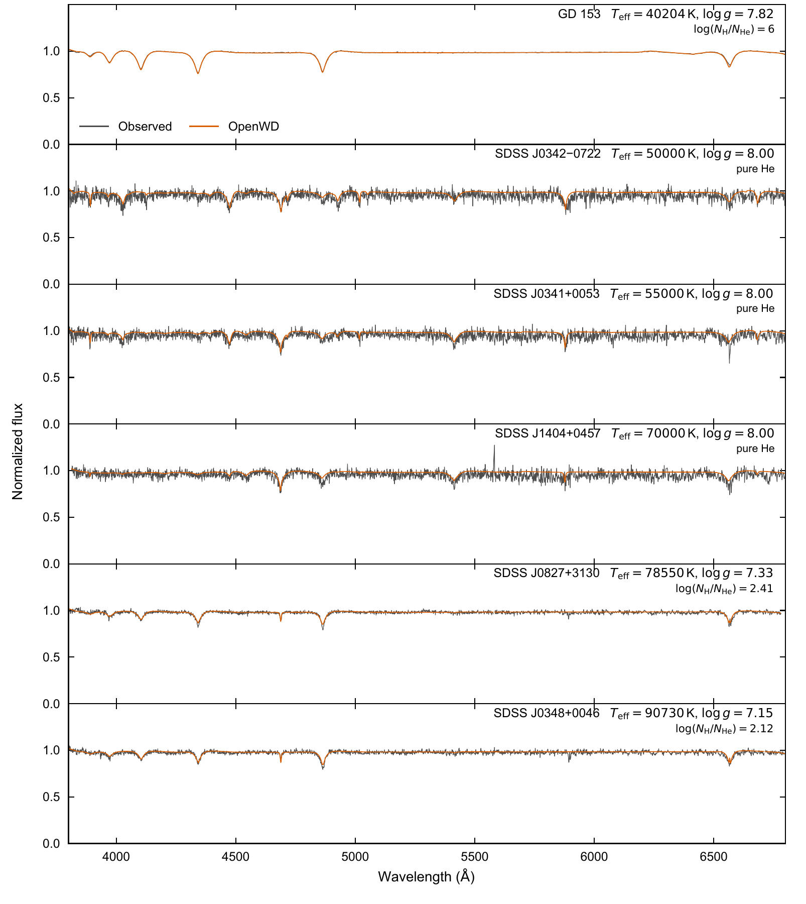
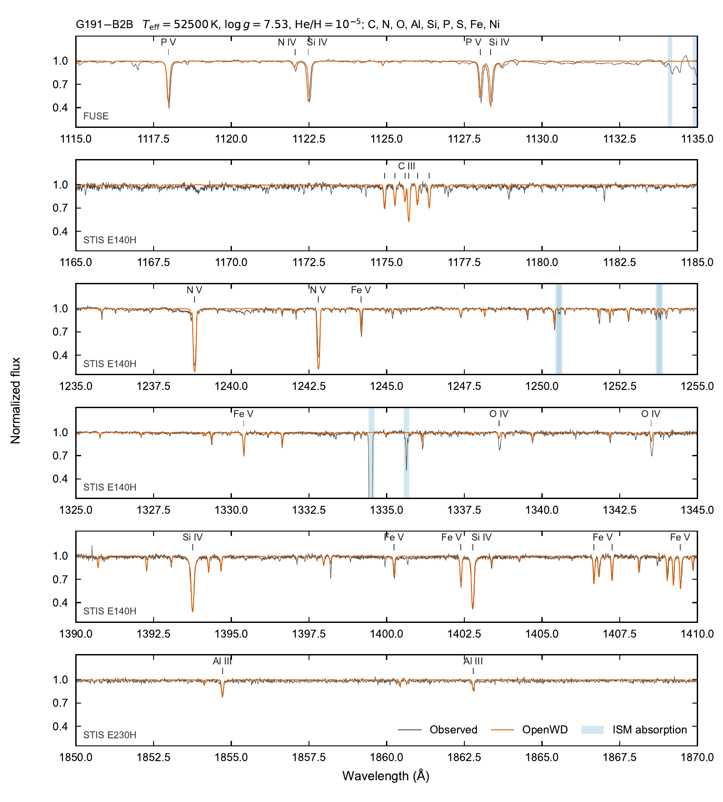

# DO and DAO: hot helium and hydrogen–helium NLTE atmospheres

[Model guide](README.md) · [Getting started](../getting-started.md)

`DOConfig` describes a hot pure-helium atmosphere. `DAOConfig` describes a hot,
homogeneous hydrogen–helium atmosphere. Set its composition with
`log_hydrogen_to_helium` = log10 N(H)/N(He). A large value, for example 6,
gives a hot DA in the hydrogen-dominated limit.

The model solves the temperature and the NLTE populations of hydrogen and
helium together. The electron density and gas pressure come from the LTE
equation of state. The module is for effective temperatures (Teff) above
about 40,000 K.

A high Teff in `DAConfig`, `DBConfig` or `DABConfig` does not select NLTE.
Use `DOConfig` or `DAOConfig`.

## Run it

```python
from wd_spectra import DOConfig, DAOConfig, run_model

run = run_model(
    DOConfig(effective_temperature=60000, logg=8.0),
    "results/do-60000",          # must be a new directory
    require_convergence=True,
)
print(run.spectrum_path)

# Hot DAO with 100 hydrogen nuclei per helium nucleus:
run_model(
    DAOConfig(effective_temperature=60000, logg=8.0, log_hydrogen_to_helium=2),
    "results/dao-60000",
    require_convergence=True,
)
```

The same calculation from the command line:

```bash
python examples/one_shot_do.py --teff 60000 --logg 8 --output results/do-60000
python examples/one_shot_do.py --teff 60000 --logg 8 \
  --log-hydrogen-to-helium 2 --output results/dao-60000
```

Every run is a cold start. It starts from a new LTE atmosphere and accepts no
saved model. `compute_do` and `compute_dao` do the same calculation and return
a `ModelResult` in memory.

Runtimes for one thread at standard quality:

- DO: 1–2 h.
- DAO: 2–5 h.
- Hot DA (GD 153) at production quality: 2–3 h.

A standard calculation can use about 7 GB of memory. Run one model at a time
with one BLAS/OpenMP thread (`OMP_NUM_THREADS=1 OPENBLAS_NUM_THREADS=1`).
`quality="quick"` skips the LTE initialization and does two iterations. Use it
only to test the interface.

The output directory contains `spectrum.txt`, `atmosphere.npz`,
`metadata.json`, `model-run.json` and `populations.npz`. Wavelengths are vacuum
Angstroms. Flux is surface `F_lambda` in erg s⁻¹ cm⁻² Å⁻¹. The third column of
`spectrum.txt` is the line-free continuum.

### Trace metals

The G191-B2B workflow adds NLTE trace metals to a converged DAO atmosphere. It
is a research script, not a configuration class. All atomic data and the
observations are installed with OpenWD.

```bash
python research/hot_daz_g191b2b.py --quality production --tolerance 1e-3 --output g191b2b-80
python research/plot_g191b2b_validation.py --model g191b2b-80 --output g191b2b.pdf
```

The production run takes about 5 h for the H/He atmosphere and 5 h for the
metals. `--quality standard` (40 depths) takes about 3 h in total.

## Options

| Option | Default | Meaning |
| --- | --- | --- |
| `effective_temperature` | 70000 | Teff in K. |
| `logg` | 8.0 | log10 of surface gravity (cm s⁻²). |
| `log_hydrogen_to_helium` | 2.0 | `DAOConfig` only: log10 N(H)/N(He). |
| `quality` | `"standard"` | `"quick"`: 20 depths, 2 angles. `"standard"`: 40 depths, 3 angles. `"production"`: 80 depths, 4 angles. |
| `maximum_helium_ii_level` | 32 | Highest explicit He II shell (2–32). |
| `maximum_hydrogen_level` | 8 | `DAOConfig` only: highest explicit H I shell (2–20). |
| `population_maximum_iterations` | 120 | Iteration limit for each continuation stage. |
| `population_tolerance` | 1e-4 | Largest relative population change at convergence (at most 1e-3). |
| `hydrogenic_collision_model` | `"tlusty-mihalas"` | He II collision rates; or `"ccc-scaled"`. |
| `helium_i_profile` | `"Tremblay26.txt"` | He I line-profile table; or `"Beauchamp25_LD.txt"`, `"Beauchamp25_NLD.txt"`. |
| `helium_ii_interpolation` | `"series-adaptive"` | He II profile interpolation; or `"synspec-quadratic"`, `"log-bilinear"`. |

## Physics

- **Equations.** The shared trust-region Newton solver finds the temperatures
  and the NLTE level populations at all depths together. The structure is
  plane-parallel, static and hydrostatic, on a column-mass grid.
- **Energy balance.** The net radiative heating, ∫(κJ − η) dλ, is zero in
  each layer, with η from the NLTE populations. The total flux is constant
  with depth.
- **Equation of state.** The electron density and gas pressure come from the
  LTE H/He equation of state, with the occupation probabilities of Hummer &
  Mihalas (1988). NLTE ionization does not change them.
- **Radiation field.** Hydrogen and helium share one radiation field with
  overlapping opacity and one electron-scattering term. A column-mass
  Feautrier solver gives the transfer solution.
- **Model atoms.** He I uses the 14-level TLUSTY atom: five explicit terms and
  superlevels for n = 3–8. He II has shells through n = 32 and He III. DAO adds
  H I shells through n = 8 and H II.
- **Rates.** Hydrogen collisions use convergent close-coupling (CCC) cross
  sections through n = 8 and TLUSTY/Mihalas rates above. He I collision fits
  and He II hydrogenic rates come from TLUSTY (Hubeny & Lanz 2017).
  Transitions without a computed radiation field use J = B (Planck).
- **Line profiles.** He I uses the profiles of Tremblay et al. (2026), He II
  the tables of Schöning & Butler (1989), and hydrogen the Stark profiles of
  Tremblay & Bergeron (2009).
- **Initialization.** The calculation first converges an LTE atmosphere. It
  then increases the NLTE contribution from 0 to 1 in steps and converges the
  atmosphere at each step (Auer & Mihalas 1969; Hubeny & Lanz 2017).
- **Convergence checks.** A model passes when the population change is below
  `population_tolerance` and all five atmosphere checks pass: all-depth flux
  (3e-3), local energy balance (3e-3), temperature stationarity (3e-4),
  scattering-source closure (1e-6) and lower-boundary screening (3e-3). See
  [limitations](../limitations.md).

### Trace metals

- The H/He atmosphere is fixed. The metals do not change its temperatures,
  electron density or energy balance. This is valid only for trace abundances.
- The metal populations are solved in the radiation field of the H/He
  opacity plus the metal line and continuum opacity.
- C, N, O, Al, Si, P and S keep the low levels of each ion from the doubly
  ionized stage upward. Fe and Ni keep all bound levels of IV–VII, with the
  VIII ground level on top. The atoms have 3804 NLTE levels.
- Fe and Ni lines come from the Kurucz measured-level lists, with missing EUV
  transitions to the ground term added from the Kurucz level files.
- Photoionization uses Verner et al. (1996) for ground levels, Opacity Project
  data for C III–IV and O IV–VI, and hydrogenic cross sections otherwise.
  Collisions use CHIANTI for C and O and van Regemorter (1962) otherwise.
- The truncated Fe and Ni atoms get the missing recombination from the
  published total rates, with the inverse rate from detailed balance.
- The iteration uses a line-weighted approximate lambda operator (Rybicki &
  Hummer 1991) with Anderson acceleration. It stops when one more update
  changes the emergent flux by less than 3e-3 longward of 900 Å.

The [development note](../development/hot-daz-trace-metals.md) gives the
convergence studies and numerical choices.

### Bundled atomic data

OpenWD installs all inputs for DO, DAO and the trace metals: the CCC hydrogen
collision data, the TLUSTY He I atom and collision fits, the He I and He II
profile tables, and the metal atomic data. No download is necessary. To use a
complete custom data tree, pass `data=ModelData.default(root)` or set
`OPENWD_DATA`. Missing files cause an error. See `THIRD_PARTY_NOTICES.md` for
attribution.

## Validation

### DO, DAO and hot DA spectra

[](../assets/do-dao-paper.pdf)

Observed spectra (SDSS; HST/STIS for GD 153) and OpenWD predictions. All
parameters are fixed to published values: DOs from
[Hügelmeyer et al. (2005)](https://doi.org/10.1051/0004-6361:20053280), DAOs
from [Tremblay et al. (2011)](https://doi.org/10.1088/0004-637X/730/2/128) and
GD 153 from [Bohlin et al. (2020)](https://doi.org/10.3847/1538-3881/ab94b4).
The models reproduce the spectra well. Some line profiles, mainly Hβ, differ
slightly.

| Object | Class | Teff (K) | log g | log10 N(H)/N(He) |
| --- | --- | ---: | ---: | ---: |
| GD 153 | Hot DA | 40204 | 7.82 | 6.00 |
| SDSS J0342−0722 | DO | 50000 | 8.00 | pure He |
| SDSS J0341+0053 | DO | 55000 | 8.00 | pure He |
| SDSS J1404+0457 | DO | 70000 | 8.00 | pure He |
| SDSS J0827+3130 | DAO | 78550 | 7.33 | 2.41 |
| SDSS J0348+0046 | DAO | 90730 | 7.15 | 2.12 |

Every model is a cold start. The DOs and DAOs use 40 depths; GD 153 uses 80
depths. Data and models are normalized with the same procedure.

### G191-B2B with NLTE trace metals

[](../assets/g191b2b-trace-metals-paper.pdf)

FUSE and HST/STIS E140H/E230H spectra of G191-B2B and the OpenWD model. The
host has Teff = 52,500 K, log g = 7.53 (Barstow et al. 2003) and
N(He)/N(H) = 1e-5. The metal abundances are those of
[Preval et al. (2013)](https://doi.org/10.1093/mnras/stt1604). Nothing is
fitted. Blue shading marks interstellar absorption. The model reproduces most metal
lines. The O IV lines are too weak by about a factor of two. At the
three-times-higher oxygen abundance of the TMAP model of Rauch et al. (2013),
OpenWD also reproduces O IV.

## Limitations

- The electron density and gas pressure are LTE. Thus the model is restricted
  NLTE, not a charge-consistent NLTE atmosphere.
- The model atoms are truncated. Some transitions use a Planck radiation
  field.
- DO and DAO contain only H and He. Metals, radiative acceleration, winds and
  diffusion are not included.
- Stars with high-excitation lines (Werner et al. 1995) are not reproduced.
- Trace metals do not change the H/He structure, so metal blanketing is
  absent. Radiative levitation and stratification are not included.

## Tested range

These fresh cold starts pass all checks at standard quality (40 depths,
He II 32, 3 angles, one thread). They are tested points, not a validated grid.

| Model | Teff (K) | log g | log10 N(H)/N(He) | Time |
| --- | ---: | ---: | ---: | ---: |
| DO | 50000 | 8.0 | pure He | 1.7 h |
| DO | 55000 | 8.0 | pure He | 2.1 h |
| DO | 60000 | 8.0 | pure He | 1.2 h |
| DO | 70000 | 8.0 | pure He | 1.1 h |
| DO | 90000 | 8.0 | pure He | 1.1 h |
| DO | 120000 | 8.0 | pure He | 1.1 h |
| DAO | 40000 | 8.0 | 0 | 3.4 h |
| DAO | 60000 | 8.0 | 2 | 4.7 h |
| DAO | 100000 | 8.0 | 2 | 1.9 h |
| Hot DA (GD 153) | 40204 | 7.82 | 6 | 2.8 h |
| Hot DA (GD 153), production, He II 8, H8 or H20 | 40204 | 7.82 | 6 | 2–3 h |

The trace-metal workflow is tested at G191-B2B (above): standard quality as a
canary test and production quality for the figure. The canary tests
`tests/test_hot_cold_canary.py` and `tests/test_hot_daz_g191b2b_canary.py`
repeat these cold starts. See [tested points](../tested-temperature-ranges.md)
for all classes.
