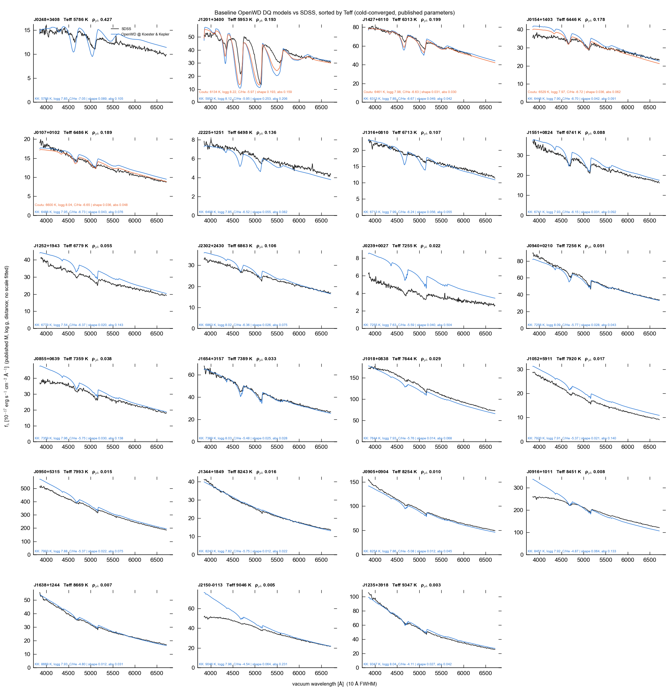
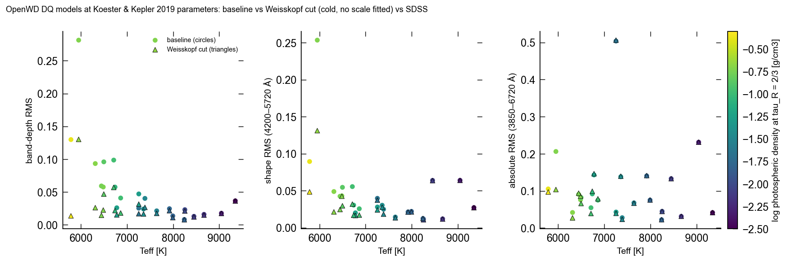

# DQ: helium atmospheres with carbon

[Model guide](README.md) · [Getting started](../getting-started.md)

`DQConfig` computes hydrogen-free, nonmagnetic, helium-dominated LTE
atmospheres with trace carbon and C₂. The transfer is refractive in both the
structure and the final spectrum. Each request is a cold start from a gray
seed. OpenWD does not fit observations.

All DQ data are bundled; see [Getting started](../getting-started.md) for the
installation.

## Run a model

```python
from wd_spectra import DQConfig, run_model

run = run_model(
    DQConfig(
        effective_temperature=9347,
        logg=8.041,
        log_carbon_to_helium=-4.107,  # log10 N(C)/N(He)
    ),
    "results/dq-9347",                # must be a new directory
    require_convergence=True,
)
spectrum = run.spectrum  # vacuum wavelength (Å), surface F_lambda
```

A DQ run can take several hours and several GiB of memory. It runs in an
isolated worker with one numerical thread. Progress is printed and written to
`worker/progress.json` in the output directory. Run one object at a time.

`compute_dq(config, output_directory=...)` returns the result in memory. Its
optional `wavelength` array changes only the output grid.

## Options

| Option | Default | Effect |
| --- | --- | --- |
| `effective_temperature` | 8000 K | Teff. |
| `logg` | 8.0 | log10 of the surface gravity (cgs). |
| `log_carbon_to_helium` | -5.0 | log10 N(C)/N(He). Allowed range: -12 to -3. |
| `quality` | `"standard"` | The only accepted value. |
| `maximum_seconds` | 28800 | Wall-clock budget. The run raises an error when it is used up. |
| `include_c2_ca` | `True` | C₂ C–A band opacity. `False` is a diagnostic omission. |
| `swan_helium_broadening` | `"none"` | `"exomol-weisskopf"` turns on the empirical Swan-line cut described below. |

## Physics

- **Equation of state.** The helium fluid uses the He-REOS.3 table
  (Becker et al. 2014). Only its departure from the ideal monatomic gas,
  ln(ρ/ρ_ideal) and u − 3kT/2m, is interpolated: PCHIP in log P and a monotone
  C¹ Hermite in log T. c_P, Q and ∇ad are analytic derivatives of the same
  interpolant. Linear interpolation in log T had given ∇ad jumps of up to 40%
  at the isotherms and stalled convective models. He, C and C₂ are in coupled
  chemical equilibrium.
- **Continuum.** The He⁻ free–free opacity includes the dense-helium
  correction of Iglesias et al. (2002). The fluid structure factor comes from
  a Rogers–Young closure (checked against Monte Carlo), and the table extends
  to 2.91 g cm⁻³. The 1/|ε|² factor of Blouin et al. (2018) is not applied,
  because the refractive transfer already supplies the 1/n propagation factor
  ([record](../development/history/dq-dense-he-ff-2026-10-15.md)).
- **Carbon line wings.** At n_He ≈ 10²²–10²³ cm⁻³, the far red Lorentz wings
  of the UV C I lines used to dominate the optical continuum of cool DQs. The
  C*–He upper states are repulsive (Allard & Spiegelman 2024), so the red wing
  is bounded by the ground-state Boltzmann factor exp(−h|Δν|/kT). Blue wings
  and line cores are unchanged. Unified C–He profiles would replace this bound.
- **C₂ Swan bands.** The Hornkohl/Parigger line list (Parigger et al. 2015) is
  scaled to the band strength of Brooke et al. (2013). ExoMol 8states
  (Yurchenko et al. 2018; McKemmish et al. 2020) fills the levels outside its
  coverage. The density shift of the bands follows Blouin et al. (2019)
  (0.2ρ eV, integrated over each depth cell). NEVPT2 C₂–He calculations
  give the same mean shift. Lines otherwise have thermal Doppler profiles.
- **Optional Swan cut (empirical).** `swan_helium_broadening="exomol-weisskopf"`
  gives each Swan line an ExoMol impact Lorentzian, cut off at the Weisskopf
  detuning. The cut discards the Lorentz area beyond it: 60–95% of the line
  strength at n_He = 10²²–10²³ cm⁻³. That makes the bands of cool DQs
  shallower and closer to SDSS (see below), but it is not
  strength-conserving physics. It is off by default.
- **Other C₂ systems.** ExoMol 8states gives the other systems and the
  partition function. The Deslandres–d'Azambuja (C–A) system uses band
  envelopes from the Einstein coefficients of Lino da Silva (2024).
- **Atomic carbon.** C I–IV lines come from the Atomic Line List v3
  (van Hoof et al. 2018).
- **Transfer.** Refractive radiative transfer includes bent and trapped
  rays, scattering and a screened lower boundary. The method follows
  Blouin et al. but is not an exact copy.
- **Solver.** DQ supplies only physics to the shared structure solver,
  which runs unmodified, as for cool DBs. When boundary screening fails, the
  bottom pressure rises fourfold and the solve repeats. See the
  [October 2026 audit record](../development/history/dq-shared-solver-2026-10-14.md).
- **Sampling.** The structure uses every fourth wavelength node of the
  combined line and continuum grid. The final spectrum uses the full grid.
- **Acceptance.** A run must pass the five atmosphere checks. It must then
  pass an independent bolometric check on 218,520 wavelength points:
  |F_bol/(σ Teff⁴) − 1| ≤ 0.002. No flux is rescaled. A failed check raises
  an error.

## Validation

[](../assets/dq-sample-montage.png)

Twenty-three DQs from Koester & Kepler (2019) were modeled, 5786–9347 K, with
SDSS DR17 spectra at S/N ≥ 15. Each uses the Koester & Kepler Teff, log g and
C/He. The flux scale is (R/d)², from the published mass and the Gaia
parallax. Nothing is fitted. All 23 models converged from cold starts. In the
figure, SDSS is black, the default model blue, and the model at Coutu et al.
(2019) parameters orange where available.

[](../assets/dq-sample-scores.png)

The scores are RMS differences after 10 Å smoothing: band depth, continuum-
normalized shape (4200–5720 Å) and absolute flux (3850–6720 Å). Circles are
the default model; triangles add the optional Swan cut. Color is the density
at τR = 2/3.

| Teff | Photospheric ρ | Default model | With the Swan cut |
| --- | --- | --- | --- |
| ≳ 7000 K | ≲ 0.05 g cm⁻³ | Good: band-depth RMS 0.01–0.05, shape 0.01–0.06 | Unchanged |
| 6300–7000 K | 0.05–0.2 g cm⁻³ | Acceptable: bands up to ~0.1 too deep | Depth error about halved |
| ≲ 6000 K | ≳ 0.2 g cm⁻³ | Bands far too deep (J1201: 0.28) | Good to 5800 K, except J1201 (0.13) |

The largest absolute-flux misfits (J0239, J2150) come from the flux scale or
calibration, not the band shapes. The Swan cut is never meaningfully worse.

Peculiar DQs (J0804, J1803; Teff < 6000 K, ρ ≈ 0.4–1 g cm⁻³) are not
reproduced. Their modeled Swan bands are about twice too deep, and the
band shapes and positions differ from the observed ones. Tested and rejected:

- full Voigt, Lorentz or ab initio quasi-static Swan profiles;
- the Blouin et al. recipe;
- turning off refraction or the dense He⁻ ff correction;
- He–He–He collision-induced absorption;
- fitting C/He (as a diagnostic).

A real fix needs C₂–He line shapes at fluid densities. Earlier four-star
figures (`dq-paper.png`) were made with the previous DQ physics.

## Limitations

- Only trace-carbon, hydrogen-free, nonmagnetic DQs are in scope. Hot
  carbon-dominated DQs, hydrogen-bearing DQs and DQp stars are not.
- The dense-mixture EOS, the molecular collision profiles and the gray
  refractive ML2 coupling are approximations.
- Below about 6300 K (photospheric ρ ≳ 0.2 g cm⁻³) the default Swan bands are
  too deep. Peculiar DQs are not reproduced, with or without the Swan cut.
- The optional Swan cut discards line strength and is not a physical line
  profile.
- The C–A system is a band-envelope approximation, not a resolved line list.
- The bolometric check fixes the integrated flux, not its wavelength
  distribution. The stride-four structure sampling is not a 1% spectral bound.

See [limitations](../limitations.md) for the shared caveats.

## Tested range

See [tested points](../tested-temperature-ranges.md).

## Regression tests

The fast test suite covers the chemistry, transfer and controller. The fixed
spectrum check, `python tools/validate.py spectra --case dq-j1311`, uses the
current default physics. The cold canary solves J1235 from scratch:

```sh
python tools/validate.py cold --case dq-j1235 --jobs 1 --timeout 28800 --output results/dq-cold-check
```

The [transfer-kernel record](../development/history/dq-ca-default-2026-09-17.md)
describes the bitwise tests of the DQ transfer kernels.
