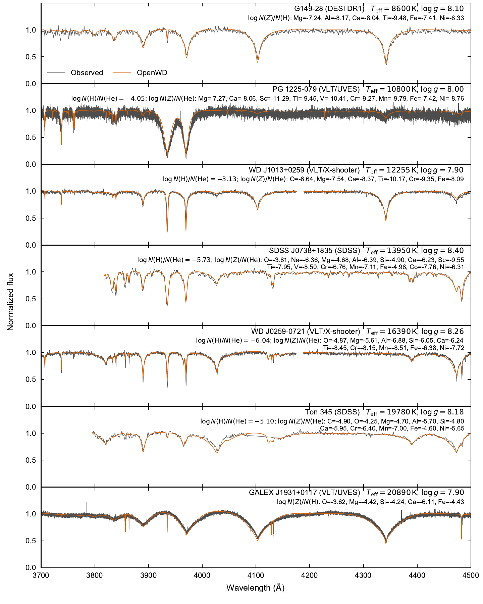
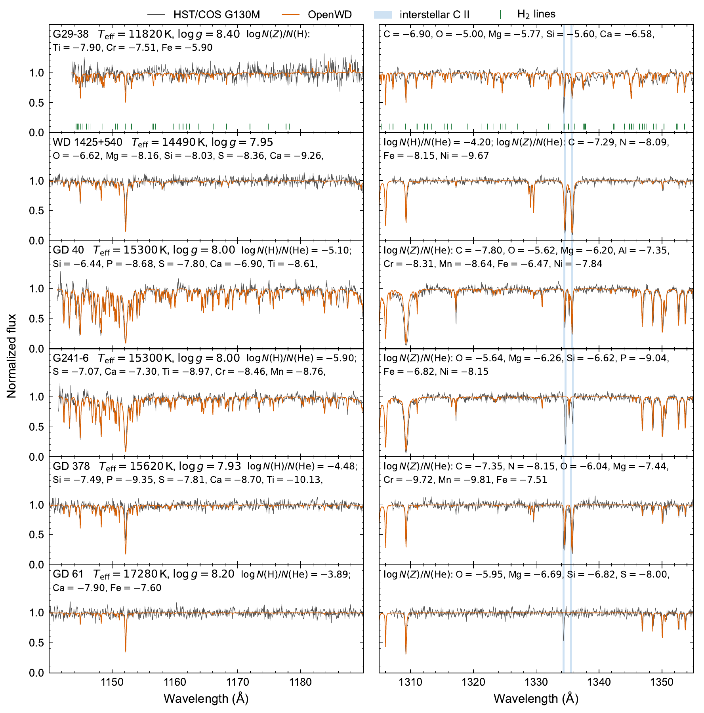
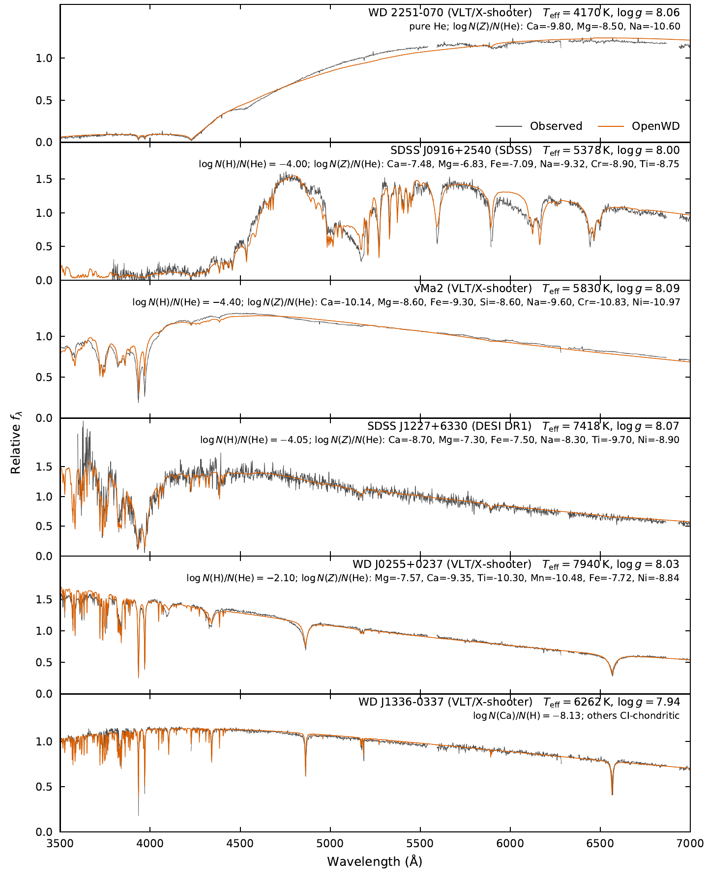

# Metal-polluted atmospheres: DZ, DBZ and DAZ

[Model guide](README.md) · [Getting started](../getting-started.md) ·
[Observational comparisons](../validation/dz-observational-comparisons.md)

OpenWD computes LTE atmospheres of white dwarfs with metals in a helium or
hydrogen host. You give the effective temperature (Teff), the surface gravity
(log g) and the abundances. OpenWD solves a new atmosphere and returns the
emergent surface spectrum. It does not fit observations.

| | `DZConfig` (DZ, DBZ) | `DAZConfig` (DAZ) |
| --- | --- | --- |
| Host | Helium, with optional trace hydrogen | Hydrogen |
| Abundances | log10 N(Z)/N(He); trace H as `log_hydrogen_abundance` = log10 N(H)/N(He) | log10 N(Z)/N(H) |
| Convection | ML2, alpha = 1.25 | ML2, alpha = 0.7 |
| Default mixture | GD 40 | G29-38 |
| In-memory function | `compute_dz` | `compute_daz` |

The metals can be any of C, N, O, F, Ne, Na, Mg, Al, Si, P, S, Ar, Ca, Sc, Ti,
V, Cr, Mn, Fe, Co, Ni, Cu and Zn. All required data are bundled; see
[Getting started](../getting-started.md) for the installation.

## Run a model

```python
from wd_spectra import DAZConfig, DZConfig, run_model

# Helium host (DBZ): GD 40
dz = run_model(
    DZConfig(
        effective_temperature=15_300, logg=8.0,
        log_hydrogen_abundance=-6.16,          # log10 N(H)/N(He)
        abundances={"C": -7.2, "O": -5.61, "Mg": -6.24, "Si": -6.76, "Ca": -6.88,
                    "Ti": -8.61, "Cr": -8.31, "Mn": -8.62, "Fe": -6.48},  # log10 N(Z)/N(He)
        quality="standard",
    ),
    "results/dz-gd40",
    require_convergence=True,
)

# Hydrogen host (DAZ): G29-38
daz = run_model(
    DAZConfig(
        effective_temperature=11_820, logg=8.40,
        abundances={"C": -6.90, "O": -5.00, "Mg": -5.77, "Si": -5.60, "Ca": -6.58,
                    "Ti": -7.90, "Cr": -7.51, "Fe": -5.90},  # log10 N(Z)/N(H)
        quality="standard",
    ),
    "results/daz-g29-38",
    require_convergence=True,
)

spectrum = dz.spectrum  # vacuum wavelength (Å), surface F_lambda, line-free continuum
print(dz.convergence_verified, daz.convergence_verified)
```

Each call is a cold start and needs a new output directory. A standard DAZ run
takes minutes on one core. A line-rich DZ can take up to a few hours. The
abundance dictionary replaces the whole default mixture. With
`require_convergence=True`, an uncertified atmosphere raises an error.

The scripts `examples/one_shot_dz.py` and `examples/one_shot_daz.py` do the
same from the command line (`--help` lists the flags).

## Options

| Option | Applies to | Default | Effect |
| --- | --- | --- | --- |
| `effective_temperature`, `logg` | both | DZ 15300 K, 8.0; DAZ 11820 K, 8.40 | Stellar parameters. |
| `abundances` | both | GD 40 (DZ), G29-38 (DAZ) | Log number ratios to the host. |
| `log_hydrogen_abundance` | DZ | -6.16 | log10 N(H)/N(He). Use `None` for no hydrogen. |
| `quality` | both | `"standard"` | `"quick"` (20 depths, interface test only), `"standard"` (40), `"production"` (80). |
| `maximum_metal_charge` | both | 3 | Highest ion charge of each metal. |
| `formal_maximum_metal_lines` | both | `None` (20,000; 1000 for `quick`) | Line budget of the spectrum. The structure uses the same list. |
| `formal_minimum_metal_oscillator_strength` | both | 1e-4 | Smallest f-value in the line list. |
| `strong_line_atomic_data` | both | `"stout"` | `"nist-asd"` replaces matched transitions with NIST ASD values. |
| `ca_ii_resonance_source` | both | `"chianti-reduced"` | Ca II H and K source function. `"lte"` uses LTE. |
| `kurucz_electron_stark` | both | `True` | Kurucz electron-impact widths for lines without a tabulated width. |
| `lyman_profile_source` | both | DZ `"stark"`, DAZ `"allard"` | Lyman-line profiles. |
| `metal_neutral_h_broadening` | DAZ | `"barklem"` | Neutral-H widths of metal lines. `"unsold"` uses Unsöld widths only. |
| `h2_lyman_werner_lines` | DAZ | `False` | Adds H₂ Lyman and Werner lines to the final spectrum. |
| `dense_helium_eos` | DZ | `"reos3"` | He-REOS.3 helium fluid. `"ideal"` uses the dilute DB EOS. |
| `dense_helium_free_free` | DZ | `"rogers-young"` | Dense-fluid He⁻ free–free reduction. `"off"` removes it. |
| `helium_minus_free_free` | DZ | `"partial-wave"` | He⁻ free–free shape below 0.5063 µm. `"automatic"` uses the Carbon et al. (1969) fit. |
| `ca_ii_he_unified_profile`, `mg_ii_he_unified_profile`, `mg_i_b_he_unified_profile`, `na_i_he_unified_profile`, `si_ii_he_unified_profile` | DZ | `True` | Unified He profiles of Ca II H&K, Mg II h&k, Mg I b, Na I D and Si II 1260–1265 Å. `False` uses impact widths. |
| `unified_metal_helium_profiles` | DZ | `"production"` | Mg I 2852 Å and Ca I 4227 Å unified He profiles. `"off"` removes them. |
| `level_resolved_photoionization` | DZ | `True` | Level-resolved metal photoionization. `False` uses Verner ground-state fits only. |
| `occupation_probability_metal_partitions` | DZ | `True` | Occupation-probability metal partition functions. `False` uses a fixed 0.1 eV cutoff. |

The remaining fields are numerical controls. Keep their defaults.

## Physics

### Metal physics (both hosts)

- **Charge and opacity.** All ions share one electron density. Metal
  electrons, bound–free opacity and lines enter the atmosphere structure,
  not only the final spectrum.
- **Trace approximation.** Metals are left out of the pressure, mass density
  and thermodynamic derivatives. These come from the host EOS. Metal-rich
  mixtures need the [D6 module](D6.md).
- **Atomic data.** Levels and transitions come from the Atomic Line List v3
  (van Hoof et al. 2018) in Stout format. Selected Kurucz (2011) transitions
  are added; see the [atomic-data notes](../../src/wd_spectra/data/atomic/README.md)
  and the [Kurucz selection check](../validation/independent-kurucz.md).
  Ionization energies come from NIST ASD.
- **Continuum.** Helium hosts use level-resolved Opacity Project cross
  sections for C I–II, O I–II, Mg I–II, Al II, Si I–II, S II and Fe II.
  Other ions, and all ions in hydrogen hosts, use Verner et al. (1996) fits.
- **Lines.** The spectrum includes electric-dipole lines with f ≥ 1e-4, up to
  20,000 lines. The structure includes the same lines, opacity-sampled at
  R = 1000. Profiles are Voigt functions. The widths come from:
  - radiative damping (Kurucz 2011, or the summed level decay rates);
  - electron impact (measured or semiclassical widths for strong Na I, Mg I,
    Mg II and Ca II lines; Kurucz Stark constants; otherwise the SYNSPEC
    n_eff⁵ scaling);
  - neutral perturbers (Unsöld 1955; Barklem et al. 2000 for H where tabulated).
- **Ca II H and K.** The final spectrum uses a non-LTE source function with
  coherent scattering. Collisional destruction uses CHIANTI rates
  (Del Zanna et al. 2021). Radiative destruction goes through the infrared
  triplet. The populations stay LTE.

### Helium hosts (DZ, DBZ)

- **Equation of state.** Inside the He-REOS.3 table (Becker et al. 2014), the
  helium mass density and internal energy come from the table. The first
  ionization potentials of C, Na, Mg, Ca and Fe are lowered with the
  dense-helium fit of Blouin et al. (2018).
- **He⁻ free–free.** The dilute coefficient is reduced for a dense fluid
  (Iglesias et al. 2002). The helium structure factor uses the Rogers–Young
  closure (Rogers & Young 1984) with the Ross & Young (1986) potential.
- **Unified line profiles.** Ca II H&K, Mg II h&k, Mg I b and Na I D use
  unified He profiles computed for OpenWD (paper appendix), for 3000–12000 K and
  n(He) = 1e19–1e23 cm⁻³. Mg I 2852 Å and Ca I 4227 Å use the profiles of
  Allard et al. (2018) and Blouin et al. (2019). Si II 1260–1265 Å uses a
  unified Si⁺–He profile. At n(He) ≥ 1e20 cm⁻³, a table replaces the Voigt
  profile. At lower density, OpenWD uses the larger of the two.
- **Level populations.** Hummer–Mihalas occupation probabilities include
  the charged microfield. The neutral-He excluded volume applies only to
  Rydberg levels (larger than the n* = 4 orbital).
- **Trace hydrogen.** Hydrogen and helium lines follow the
  [DAB](DAB.md) and [DB](DB.md) policies.

### Hydrogen hosts (DAZ)

- The host uses the [DA](DA.md) equation of state, with H₂, H₂⁺, H⁻ and H₃⁺
  in cool atmospheres, and the DA hydrogen line policy.
- Neutral-H widths of metal lines come from Barklem et al. (2000) where
  tabulated, and from Unsöld (1955) otherwise.
- `h2_lyman_werner_lines=True` adds photospheric H₂ Lyman and Werner lines
  (Kurucz `h2bx`/`h2cx`) with fluorescent source functions. See the
  [DA guide](DA.md).
- Dense-helium physics does not apply to hydrogen hosts.

## Validation

All comparisons use published Teff, log g and abundances. Nothing is refit.
The [observational comparisons](../validation/dz-observational-comparisons.md)
give the sources, data processing and further stars.

### Seven polluted white dwarfs

[](../assets/dz-daz-paper.pdf)

Optical spectra (gray) and OpenWD models (orange) of G149-28, PG 1225-079,
SDSS J0738+1835, Ton 345, GALEX J1931+0117, WD J1013+0259 and WD J0259-0721.
Parameters come from Zuckerman et al. (2011), Klein et al. (2011), Dufour et
al. (2012), Wilson et al. (2015), Vennes et al. (2011) and Izquierdo et al.
(2023). The models reproduce most metal features. Ca II H and K in PG 1225-079
are weaker in the model than in the data.

### Far ultraviolet

[](../assets/uv-paper.pdf)

HST/COS G130M spectra (gray) and OpenWD models (orange) of G29-38,
WD 1425+540, GD 40, G241-6, GD 378 and GD 61. Parameters come from Xu et al.
(2014, 2017), Jura et al. (2012), Klein et al. (2021) and Farihi et al. (2013).
The G29-38 model includes H₂ lines (green ticks). Agreement is good in both
windows. Outside them, the Si II 1260–1265 Å wings of GD 40 and G241-6 are
weaker in the model than in the data.

### Cool DZs

[](../assets/dz-cool-paper.pdf)

Optical spectra (gray) and OpenWD models (orange) of five cool helium-host DZs
and the cool DAZ WD J1336-0337. Parameters come from Hollands et al. (2017),
O'Brien et al. (2026), Izquierdo et al. (2026), Blouin et al. (2019),
Coutu et al. (2019), Swan et al. (2023) and Kilic et al. (2026). The models
reproduce the overall spectral shapes and most line strengths. The wings of
the strongest lines in the coolest, most metal-rich stars do not match in detail.

## Fit an observed spectrum

The [DZ fitting example](../examples/fitting-dz.md) fits Ca, Mg and Fe in a
UVES spectrum of PG 1225-079 on one fixed atmosphere structure.

## Limitations

- Metals are trace species in the EOS. Use [D6](D6.md) for metal-dominated
  mixtures.
- Populations are LTE. Only Ca II H and K have a non-LTE source function.
- Unified He profiles exist only for the lines listed above. Other lines in
  dense helium use impact widths.
- The atmospheres are plane parallel and chemically homogeneous.

See [limitations](../limitations.md) for the shared caveats.

## Tested range

See [tested points](../tested-temperature-ranges.md).
