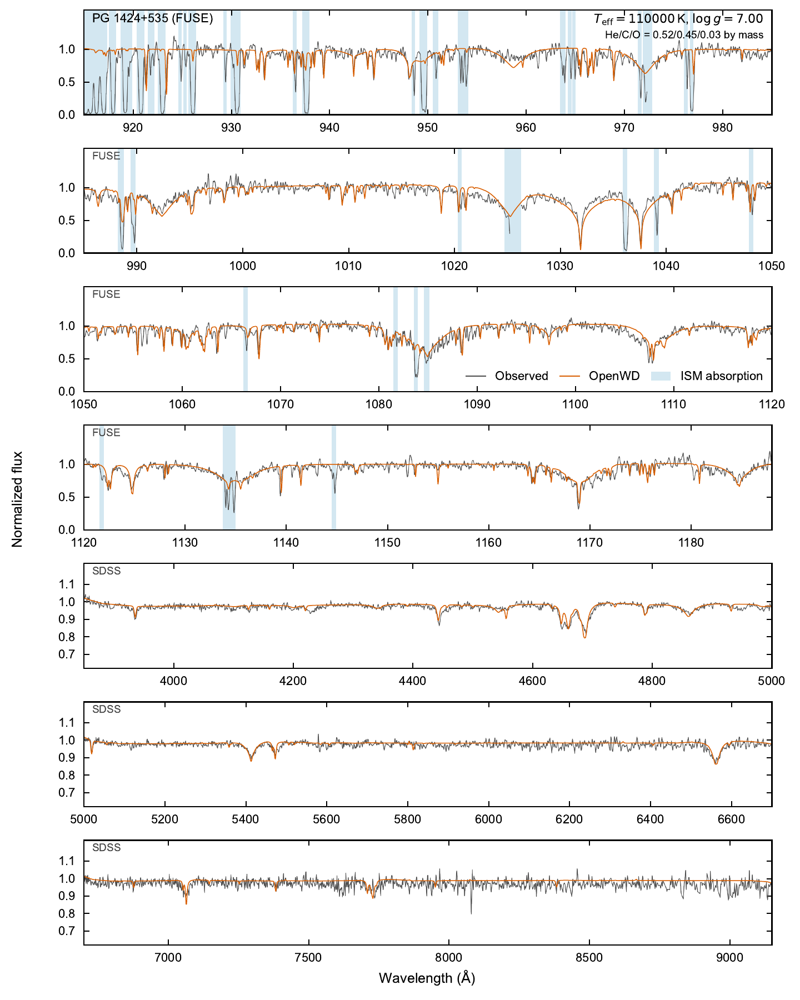

# PG 1159: hot He/C/O NLTE atmospheres

[Model guide](README.md) · [Getting started](../getting-started.md)

`PG1159Config` describes hot, hydrogen-deficient atmospheres of helium, carbon
and oxygen, for effective temperatures (Teff) of about 75,000–200,000 K. The
composition is a set of mass fractions and is the same at all depths.

The model solves the NLTE populations of He, C and O together with the
atmosphere structure. Other elements in `mass_fractions` are trace elements.
After the structure converges, the model solves their populations in the fixed
He/C/O radiation field and adds their opacity to the spectrum only.

## Run it

```python
import json
from wd_spectra import PG1159Config, run_model

# Defaults: PG 1424+535 (110,000 K, log g 7.0, Werner et al. 2015 mixture).
run = run_model(PG1159Config(), "results/pg1424")   # must be a new directory

record = json.loads((run.output_directory / "metadata.json").read_text())
print(record["model_metadata"]["atmosphere_convergence_status"])
```

A successful run prints `spectrum-qualified`. Do not set
`require_convergence=True`: it accepts only the status `converged`, which the
PG 1159 checks do not give (see [Physics](#physics)). For the same reason,
`run.convergence_verified` is `False` and `run_model` gives a warning.

Set your own star and mixture:

```python
PG1159Config(
    effective_temperature=140000, logg=7.0,
    mass_fractions={"He": 0.33, "C": 0.48, "O": 0.17, "Ne": 0.02},
    include_radiative_acceleration=True,
)
```

The same calculation from the command line:

```bash
python examples/one_shot_pg1159.py --teff 110000 --logg 7 --output results/pg1424
```

Use `--mass-fraction El=value` (repeat it) for a different mixture and
`--radiative-acceleration` to include radiation pressure.

Every run is a cold start from a gray atmosphere; no saved model is accepted.
A standard run takes 1–1.5 h on one thread, including the trace elements.
`compute_pg1159` does the same calculation and returns a `ModelResult` in
memory. Wavelengths are vacuum Angstroms. Flux is surface `F_lambda` in
erg s⁻¹ cm⁻² Å⁻¹.

## Options

| Option | Default | Meaning |
| --- | --- | --- |
| `effective_temperature` | 110000 | Teff in K. |
| `logg` | 7.0 | log10 of surface gravity (cm s⁻²). |
| `mass_fractions` | He 0.52, C 0.45, O 0.03, F 5e-5, Ne 0.01, Si 2e-4, P 3.2e-5, S 1e-4, Ar 6e-5, Fe 1.3e-3 | Mass fractions, normalized once. He, C and O must be positive. |
| `target_name` | `"PG 1424+535"` | Label saved in the output. |
| `quality` | `"standard"` | `"standard"`: 40 depths, 120 continuum points, 2 angles. `"production"`: 80 depths, 300 points, 3 angles. `"quick"` tests the interface only. |
| `oxygen_atom` | `"extended54-complete"` | O VI atom with 54 terms; `"compact14"` keeps 14 terms. |
| `include_radiative_acceleration` | `False` | Include radiation pressure in hydrostatic equilibrium. |
| `refine_upper_atmosphere` | `True` | Bring the layers above `tau_Ross` ≈ 1e-3 to local radiative equilibrium, then solve again. |
| `population_maximum_iterations` | 120 | Iteration limit of the population solution. |
| `population_tolerance` | 1e-2 | Relative population tolerance (at most 1e-2). |

If you replace `mass_fractions`, the model uses only the elements that you
give. The default mixture is the published PG 1424+535 composition with its
trace elements.

## Physics

- **Model atom.** He I and He II use the DO/DAO atoms and rates, with He II
  shells through n = 14 and He III. Carbon has 97 C III terms, 54 C IV terms
  and the C V ground level. Oxygen has 47, 83, 105 and 54 terms of O III–VI and
  the O VII ground level.
- **Atomic data.** C and O terms and lines come from the Tübingen Model-Atom
  Database (TMAD; Rauch & Deetjen 2003). The model adds Opacity Project
  photoionization, CHIANTI collision strengths (Del Zanna et al. 2021) and
  collisional mixing of angular-momentum states in high-n shells. Absorption
  and emission in each line use the same profile, so the atom gives LTE in a
  Planck field.
- **Fine structure.** The rate equations use terms. The spectrum uses
  fine-structure levels. A level takes its population from a term with the
  same n, spin and orbital angular momentum.
- **Trace elements.** N, F, Ne, Na, Mg, Al, Si, S, Ar, Ca and Fe are solved in
  NLTE on the converged structure. Other listed elements, for example P, add
  LTE line opacity. Trace elements do not change the structure.
- **Structure.** The shared trust-region solver requires radiative equilibrium
  and constant bolometric flux. The rate equations are solved to convergence
  for each trial structure. The electron density and gas pressure come from
  the NLTE ionization balance. The structure spans
  1e-8 ≤ `tau_Ross` ≤ 100.
- **Initialization.** The run starts from a gray atmosphere. A local-Planck
  stage and a half-NLTE stage prepare the full NLTE solution.
- **Upper atmosphere.** Above `tau_Ross` ≈ 1e-3 the heating depends only
  weakly on temperature, so the flux equations do not fix the temperature. The
  refinement brings these layers to local radiative equilibrium with the
  hybrid method of TMAP (Werner et al. 2003). The pressure is fixed during
  this step. The refined model is then solved again with the full equations.
- **Stark broadening.** High-n C IV and O VI lines sum the hydrogenic
  linear-Stark components, each with a Holtsmark (1919) microfield
  distribution, and add the electron-impact profile. Tabulated electron-impact
  widths are used for C IV 1548/1551 and 5801/5812 Å, O V 3p–3d and
  O VI 1032/1038 and 3811/3834 Å. Other lines use the classical SYNSPEC
  estimate.
- **Convergence checks.** The bolometric flux must equal σTeff⁴ within 1% at
  the surface and at all depths to `tau_Ross` = 100. The local radiative
  heating must balance to 0.3% at 1e-5 ≤ `tau_Ross` < 10. The scattering source
  must close to 1e-6, and the lower-boundary leak must be below 1%. Temperature
  stationarity is recorded but is not a check. A model that passes is
  `spectrum-qualified`, never `converged`.

All atomic data are installed with OpenWD. To use a complete custom data tree,
pass `data=ModelData.default(root)` or set `OPENWD_DATA`. The model reports all
missing files before it starts.

## Validation

[](../assets/pg1159-paper.pdf)

FUSE far-UV and SDSS optical spectra of PG 1424+535 and the OpenWD model. The
parameters are those of
[Werner et al. (2015)](https://doi.org/10.1051/0004-6361/201526842):
110,000 K, log g = 7.0, He/C/O = 0.52/0.45/0.03 by mass, with their F, Ne, Si,
P, S, Ar and Fe abundances. Nothing is fitted. Shading marks interstellar
absorption (blue). The model reproduces the He II, C III, C IV and O VI features. The
O VI 1032/1038 Å damping wings, He II 4686 Å and some C IV lines are too deep.

## Limitations

- The convergence tolerances are looser than for the other classes (1% flux).
- The temperatures of the outermost layers are the least certain part of the
  structure. In PG 1159-035, local radiative equilibrium is thermally unstable
  at 2e-5 < `tau_Ross` < 4e-4.
- Trace elements do not feed back on the structure. Full iron-group
  blanketing is not included.
- The atmosphere is static, plane-parallel and homogeneous. Winds, spherical
  extension and diffusion are not included.
- Known differences at published parameters: the O VI 1032/1038 Å wings are
  too deep in PG 1424+535 and PG 1159-035; He II 4686 Å and some optical C IV
  lines are too deep; PG 1159-035 has a too-strong C IV 5801 Å emission core.

## Tested range

These fresh standard cold starts with the default refinement are
`spectrum-qualified` (one thread). They are tested points, not a grid.

| Star | Teff (K) | log g | Option | All-depth flux error | Time |
| --- | ---: | ---: | --- | ---: | ---: |
| PG 1707+427 | 85000 | 7.5 | — | 0.0086 | 54 min |
| PG 1424+535 | 110000 | 7.0 | — | 0.0056 | 74 min |
| PG 1159-035 | 140000 | 7.0 | `include_radiative_acceleration=True` | 0.0025 | 90 min |

All three use their published mass fractions. The canary test
`tests/test_released_family_canaries.py` repeats the PG 1424+535 cold start
with the He/C/O mixture only.
See [tested points](../tested-temperature-ranges.md) for all classes.
