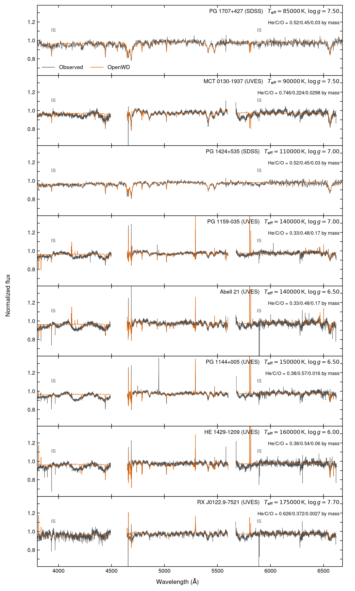
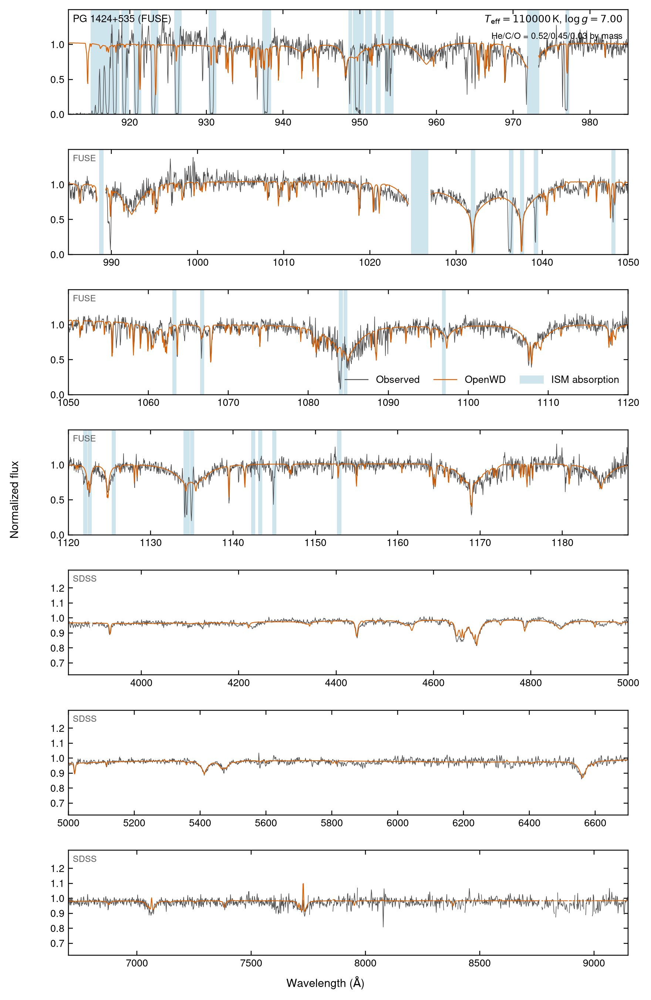
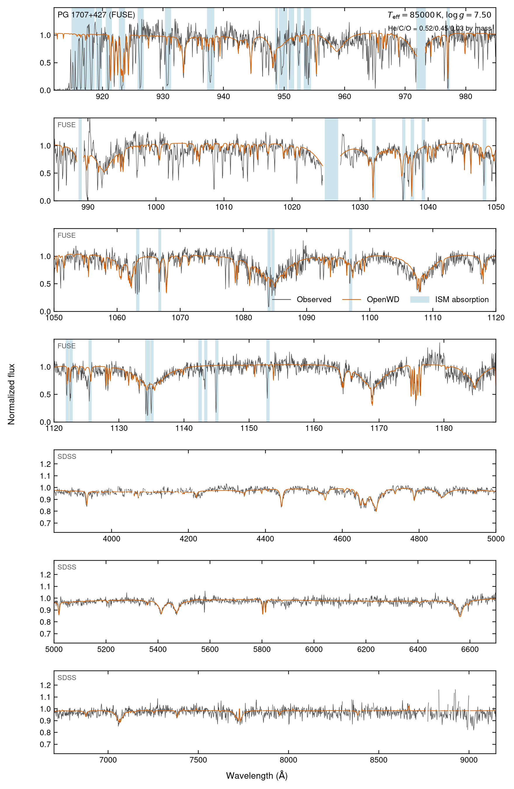
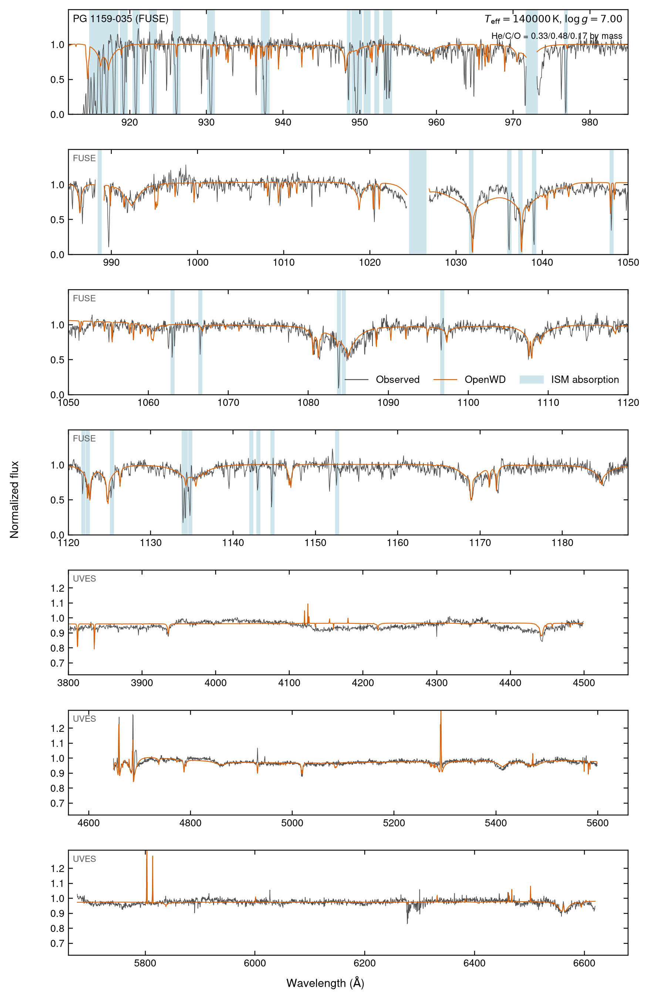

# PG 1159: hot He/C/O NLTE atmospheres

[Model guide](README.md) · [Getting started](../getting-started.md)

`PG1159Config` describes hot, hydrogen-deficient atmospheres of helium, carbon
and oxygen, for effective temperatures (Teff) of about 75,000–200,000 K. The
composition is a set of mass fractions and is the same at all depths.

The model solves the NLTE populations of He, C and O together with the
atmosphere structure. Other elements in `mass_fractions` are trace elements.
After the structure converges, the model solves their populations in the fixed
He/C/O radiation field and adds their opacity to the spectrum only.

## Run it

```python
import json
from wd_spectra import PG1159Config, run_model

# Defaults: PG 1424+535 (110,000 K, log g 7.0, Werner et al. 2015 mixture).
run = run_model(PG1159Config(), "results/pg1424")   # must be a new directory

record = json.loads((run.output_directory / "metadata.json").read_text())
print(record["model_metadata"]["atmosphere_convergence_status"])
```

A successful run prints `spectrum-qualified`. Do not set
`require_convergence=True`: it accepts only the status `converged`, which the
PG 1159 checks do not give (see [Physics](#physics)). For the same reason,
`run.convergence_verified` is `False` and `run_model` gives a warning.

Set your own star and mixture:

```python
PG1159Config(
    effective_temperature=140000, logg=7.0,
    mass_fractions={"He": 0.33, "C": 0.48, "O": 0.17, "Ne": 0.02},
    include_radiative_acceleration=True,
)
```

The same calculation from the command line:

```bash
python examples/one_shot_pg1159.py --teff 110000 --logg 7 --output results/pg1424
```

Use `--mass-fraction El=value` (repeat it) for a different mixture and
`--radiative-acceleration` to include radiation pressure.

Every run is a cold start from a gray atmosphere; no saved model is accepted.
`compute_pg1159` does the same calculation and returns a `ModelResult` in
memory. Wavelengths are vacuum Angstroms. Flux is surface `F_lambda` in
erg s⁻¹ cm⁻² Å⁻¹.

## Options

| Option | Default | Meaning |
| --- | --- | --- |
| `effective_temperature` | 110000 | Teff in K. |
| `logg` | 7.0 | log10 of surface gravity (cm s⁻²). |
| `mass_fractions` | He 0.52, C 0.45, O 0.03, F 5e-5, Ne 0.01, Si 2e-4, P 3.2e-5, S 1e-4, Ar 6e-5, Fe 1.3e-3 | Mass fractions, normalized once. He, C and O must be positive. |
| `target_name` | `"PG 1424+535"` | Label saved in the output. |
| `quality` | `"standard"` | `"standard"`: 40 depths, 120 continuum points, 2 angles. `"production"`: 80 depths, 300 points, 3 angles. `"quick"` tests the interface only. |
| `oxygen_atom` | `"extended54-complete"` | O VI atom with 54 terms; `"compact14"` keeps 14 terms. |
| `include_radiative_acceleration` | `False` | Include radiation pressure in hydrostatic equilibrium. |
| `refine_upper_atmosphere` | `True` | Bring the layers above `tau_Ross` ≈ 1e-3 to local radiative equilibrium, then solve again. |
| `refinement_local_maximum_rosseland_depth` | 1e-3 | Deepest `tau_Ross` at which the refinement imposes local radiative equilibrium; deeper layers get Unsöld–Lucy flux corrections. |
| `local_energy_minimum_rosseland_depth` | 1e-5 | Shallowest `tau_Ross` at which the solve checks local energy balance. Shallower cells copy the boundary temperature. |
| `maximum_local_energy_minimum_rosseland_depth` | 1e-3 | Deepest gate the automatic fallback may use. Set it equal to the gate to disable the fallback. |
| `rydberg_upgrades` | `True` | Use the Rydberg-level upgrades of the formal atom (see Physics). Also tightens the formal population tolerance to 1e-3. |
| `population_maximum_iterations` | 120 | Iteration limit of the population solution. |
| `population_tolerance` | 1e-2 | Relative population tolerance (at most 1e-2). |

If you replace `mass_fractions`, the model uses only the elements that you
give. The default mixture is the published PG 1424+535 composition with its
trace elements.

## Physics

- **Model atom.** He I and He II use the DO/DAO atoms and rates, with He II
  shells through n = 14 and He III. Carbon has 97 C III terms, 54 C IV terms
  and the C V ground level. Oxygen has 47, 83, 105 and 54 terms of O III–VI and
  the O VII ground level.
- **Atomic data.** C and O terms and lines come from the Tübingen Model-Atom
  Database (TMAD; Rauch & Deetjen 2003). The model adds Opacity Project
  photoionization, CHIANTI collision strengths (Del Zanna et al. 2021) and
  collisional mixing of angular-momentum states in high-n shells. Absorption
  and emission in each line use the same profile, so the atom gives LTE in a
  Planck field.
- **Fine structure.** The rate equations use terms. The spectrum uses
  fine-structure levels. A level takes its population from a term with the
  same n, spin and orbital angular momentum.
- **Trace elements.** N, F, Ne, Na, Mg, Al, Si, S, Ar, Ca and Fe are solved in
  NLTE on the converged structure. Other listed elements, for example P, add
  LTE line opacity. Trace elements do not change the structure.
- **Structure.** The shared trust-region solver requires radiative equilibrium
  and constant bolometric flux. The rate equations are solved to convergence
  for each trial structure. The electron density and gas pressure come from
  the NLTE ionization balance. The structure spans
  1e-8 ≤ `tau_Ross` ≤ 100.
- **Initialization.** The run starts from a gray atmosphere. A local-Planck
  stage and a half-NLTE stage prepare the full NLTE solution.
- **Upper atmosphere.** Above `tau_Ross` ≈ 1e-3 the heating depends only
  weakly on temperature, so the flux equations do not fix the temperature. The
  refinement brings these layers to local radiative equilibrium with the
  hybrid method of TMAP (Werner et al. 2003). The pressure is fixed during
  this step. The refined model is then solved again with the full equations.
  Local radiative equilibrium is imposed only above `tau_Ross` = 1e-3. Between
  1e-3 and 1e-2 lines dominate both heating and cooling, and local balance is
  ill-conditioned there: with the band reaching 1e-2, the refinement stalled
  or diverged in several models. Unsöld–Lucy flux corrections set the
  temperature below 1e-3.
- **Gate fallback.** In some models the shallowest cell checked for local
  energy balance (the boundary cell) stays in net heating and holds up the
  solve. Its relative residual stays above 2% while it is the worst cell.
  There are two cases:
  - Stall: the Newton step shrinks below 0.005 within two iterations (HE
    1429-1209, PG 1144+005 and RX J0122.9-7521 at published parameters).
  - Crawl: the flux has converged (below 2%), but the boundary cell stays the
    worst for eight iterations in a row (PG 1151-029).

  In either case the model restarts cold with the gate ten times deeper, up to
  `maximum_local_energy_minimum_rosseland_depth`. Restarts are recorded in
  `local_energy_gate_restarts`.
- **Rydberg upgrades of the formal atom** (`rydberg_upgrades`). These apply to
  the line-formation atom only; the structure does not change.
  - Explicit hydrogenic O VI shells (n = 11–18) and C IV shells (n = 11–22).
    Above the O VI shells, LTE shells to n = 26 are linked by Van Regemorter
    collisions. C IV has no LTE shells: in the outer layers of cooler stars the
    density is too low to hold them in LTE, and LTE shells there gave PG
    1424+535 spurious C IV emission cores. The TMAD atoms couple n ≤ 10 to their LTE reservoir only
    radiatively, so without the shells O VI 5290 goes into absorption.
  - Electron-impact collisions between l-states of the same n (Van Regemorter
    form) for O VI n ≥ 6 and C IV n ≥ 4. They replace the TMAD placeholder
    records for l ≥ 2.
  - Linear-Stark (TMAD formula 4) profiles for the formal C IV and C VI lines
    with lower n ≥ 5. Those lines previously had only classical widths.
- **Stark broadening.** High-n C IV and O VI lines sum the hydrogenic
  linear-Stark components, each with a Holtsmark (1919) microfield
  distribution, and add the electron-impact profile. Tabulated electron-impact
  widths are used for C IV 1548/1551 and 5801/5812 Å, O V 3p–3d and
  O VI 1032/1038 and 3811/3834 Å. Other lines use the classical SYNSPEC
  estimate.
- **Convergence checks.** The bolometric flux must equal σTeff⁴ within 1% at
  the surface and at all depths to `tau_Ross` = 100. The local radiative
  heating must balance to 0.3% between the gate
  (`local_energy_minimum_rosseland_depth`, 1e-5 unless the fallback deepened
  it) and `tau_Ross` = 10. The scattering source
  must close to 1e-6, and the lower-boundary leak must be below 1%. Temperature
  stationarity is recorded but is not a check. A model that passes is
  `spectrum-qualified`, never `converged`.

All atomic data are installed with OpenWD. To use a complete custom data tree,
pass `data=ModelData.default(root)` or set `OPENWD_DATA`. The model reports all
missing files before it starts.

## Validation

These models use published parameters and mass fractions; nothing is fitted.
Each model is one run of the command above:

```bash
python examples/one_shot_pg1159.py --teff 140000 --logg 7 --target-name "PG 1159-035" \
  --mass-fraction He=0.33 --mass-fraction C=0.48 --mass-fraction O=0.17 --mass-fraction Ne=0.02 \
  --wavelength-min 900 --wavelength-max 9300 --wavelength-step 0.02 --output results/pg1159/docs/pg1159
```

`research/pg1159_doc_models.sh` lists the commands, parameters and references
for every star. `research/plot_pg1159_doc_comparison.py` makes the figures
from the archival FUSE, SDSS and VLT/UVES spectra; these spectra are not
installed with OpenWD. Each model is convolved to the instrumental
resolution and shifted to the stellar velocity. Data and model are then
normalized independently and in the same way.

[](../assets/pg1159-optical.pdf)

Optical spectra of eight PG 1159 stars, from 85,000 K to 175,000 K, against the
OpenWD models. "IS" marks interstellar Ca II and Na I. The models reproduce
the He II 4686/C IV 4658 trough and the C IV 4441, 5470 and 6560 Å lines, and
O VI 5290 Å is in emission in the hottest stars. The C IV 5801/5812 Å emission
cores of the hot, low-gravity stars (Abell 21, PG 1144+005, HE 1429-1209) are
much too strong, and a few narrow model emission lines (near 4120 Å) are not
observed. The broad depression at 4100–4300 Å in the UVES spectra of the
hottest stars is not reproduced.

[](../assets/pg1159-pg1424.pdf)

[](../assets/pg1159-pg1707.pdf)

[](../assets/pg1159-pg1159.pdf)

Far-UV (FUSE) and optical spectra of PG 1424+535, PG 1707+427 and PG 1159-035.
Blue shading marks interstellar absorption; geocoronal emission is masked. The
models reproduce the He II, C III, C IV and O VI lines. The O VI 1032/1038 Å
damping wings are too deep, most strongly in PG 1159-035. C IV 7726 Å in
PG 1424+535 has a narrow emission core that is not observed.

## Limitations

- The convergence tolerances are looser than for the other classes (1% flux).
- The temperatures of the outermost layers are the least certain part of the
  structure. In PG 1159-035, local radiative equilibrium is thermally unstable
  at 2e-5 < `tau_Ross` < 4e-4.
- Trace elements do not feed back on the structure. Full iron-group
  blanketing is not included.
- The atmosphere is static, plane-parallel and homogeneous. Winds, spherical
  extension and diffusion are not included.
- Known differences at published parameters:
  - the O VI 1032/1038 Å wings are too deep in PG 1424+535 and PG 1159-035;
  - the C IV 5801/5812 Å emission cores of hot stars are too strong;
  - narrow model emission cores appear near 4120 Å and in C IV 7726 Å but are
    not observed;
  - the model line cores are narrower than observed. Emission lines that are
    doublets in the model look single in the data.
- Cooler stars spend longer in the upper-atmosphere refinement than before
  the 1e-3 refinement band: the checks pass early, but the refinement keeps
  iterating until the temperatures stop changing.

## Tested range

These cold starts are `spectrum-qualified`. Each is a standard run with the
default options and the published mass fractions. They are tested points,
not a grid. The gate column gives the local-energy gate at convergence; values
deeper than 1e-5 were reached by the automatic fallback.

| Star | Teff (K) | log g | Option | All-depth flux error | Gate |
| --- | ---: | ---: | --- | ---: | ---: |
| PG 1707+427 | 85000 | 7.5 | — | 0.0092 | 1e-5 |
| MCT 0130-1937 | 90000 | 7.5 | — | 0.0050 | 1e-5 |
| PG 2131+066 | 95000 | 7.5 | — | 0.0061 | 1e-5 |
| PG 1424+535 | 110000 | 7.0 | — | 0.0018 | 1e-5 |
| PG 1159-035 | 140000 | 7.0 | — | 0.0098 | 1e-5 |
| PG 1159-035 | 140000 | 7.0 | `include_radiative_acceleration=True` | 0.0028 | 1e-5 |
| Abell 21 | 140000 | 6.5 | — | 0.0028 | 1e-5 |
| PG 1151-029 | 140000 | 6.0 | — | 0.0090 | 1e-4 |
| PG 1144+005 | 150000 | 6.5 | — | 0.0012 | 1e-4 |
| HE 1429-1209 | 160000 | 6.0 | — | 0.0070 | 1e-3 |
| RX J0122.9-7521 | 175000 | 7.7 | — | 0.0083 | 1e-4 |

The canary test `tests/test_released_family_canaries.py` repeats the
PG 1424+535 cold start with the He/C/O mixture only.
See [tested points](../tested-temperature-ranges.md) for all classes.
