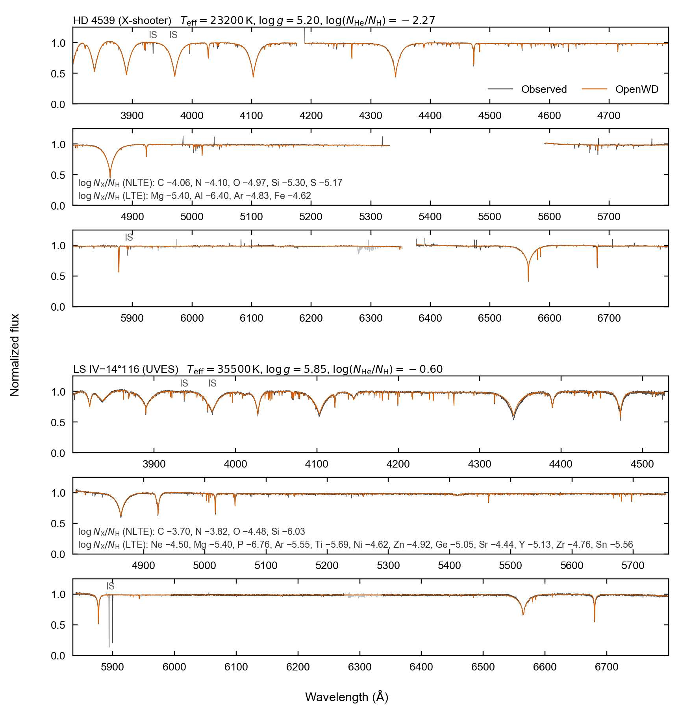

# sdB: hot subdwarf B stars

[Model guide](README.md) · [Getting started](../getting-started.md)

OpenWD computes hybrid LTE/NLTE models of hot subdwarf B (sdB) stars. These
are hydrogen–helium atmospheres at lower gravity than white dwarfs. The method
has three steps:

1. Solve an LTE H/He atmosphere structure.
2. Solve NLTE H/He populations on that fixed structure, and compute the
   spectrum.
3. Optional: add trace metals on the fixed H/He host.

`run_model` with `SdBConfig` does steps 1 and 2. A command-line driver does
step 3. OpenWD does not fit observations. All data are bundled; see
[Getting started](../getting-started.md) for the installation.

## Run a model

```python
from wd_spectra import SdBConfig, run_model

run = run_model(
    SdBConfig(
        effective_temperature=23_200, logg=5.20,
        log_helium_to_hydrogen=-2.27,  # log10 N(He)/N(H)
    ),
    "results/sdb-hd4539",
    require_convergence=True,
)
spectrum = run.spectrum  # vacuum wavelength (Å), surface F_lambda, line-free continuum
```

This model takes about 10–20 minutes on one core. The default spectrum covers
3000–9200 Å in 0.05 Å steps. The continuum column uses the same NLTE
populations with all lines removed. `run.convergence_verified` is `True` only
if the LTE structure is certified and the NLTE populations converge.
The model contains no metals.

## Options

| Option | Default | Effect |
| --- | --- | --- |
| `effective_temperature`, `logg` | 23200 K, 5.2 | Stellar parameters. |
| `log_helium_to_hydrogen` | -2.27 | log10 N(He)/N(H). This is the opposite sign to `DABConfig.log_hydrogen_to_helium`. |
| `quality` | `"standard"` | `"standard"` (40 depths) or `"production"` (80 depths). |
| `hydrogen_levels` | 16 | Explicit H I levels in the NLTE atom. |
| `helium_i_atom` | `"14"` | He I model atom: 14 or 24 terms. |
| `population_maximum_iterations` | 600 | Limit on the NLTE population iterations. |
| `population_tolerance` | 1e-4 | Largest relative population change at convergence. |

## Add trace metals

The metal driver needs the two research-driver stages as input. Run these
commands from the repository root, with one thread:

```bash
export OMP_NUM_THREADS=1 OPENBLAS_NUM_THREADS=1
python research/sdb_lte_hhe.py --teff 23200 --logg 5.20 --log-he-h -2.27 \
    --output results/sdb/hd4539-lte
python research/sdb_hybrid_nlte.py results/sdb/hd4539-lte \
    --hydrogen-levels 16 --accelerated-lambda \
    --population-iterations 200 200 200 \
    --output results/sdb/hd4539-hybrid
python research/sdb_trace_metals.py results/sdb/hd4539-lte results/sdb/hd4539-hybrid \
    --abundance C=-4.06 --abundance N=-4.10 --abundance O=-4.97 \
    --abundance Si=-5.30 --abundance S=-5.17 \
    --lte-abundance Mg=-5.40 --lte-abundance Al=-6.40 \
    --lte-abundance Ar=-4.83 --lte-abundance Fe=-4.62 \
    --output results/sdb/hd4539-metals
```

- Abundances are log10 N(X)/N(H). `--log-he-h` is log10 N(He)/N(H).
- `--abundance` solves an element in NLTE. C, N, O, Si and S are available.
- `--lte-abundance` adds an element as LTE line opacity.
- `--heavy-abundance` adds elements heavier than Zn (for example Ge, Sr, Y,
  Zr, Sn) as LTE line opacity.
- Use a new output directory for each stage.

Each stage writes `spectrum.npz` (`wavelength_vacuum` and surface `flux` in
erg s⁻¹ cm⁻² Å⁻¹) and `run-summary.json`. The drivers save outputs even when a
solve does not converge. Before you use a result, check
`atmosphere_convergence_status` (LTE stage), `populations_converged` (NLTE
stage) and `converged` (metal stage) in each summary.

## Physics

- **Structure.** The LTE H/He atmosphere comes from the [DAB](DAB.md) module.
  It contains no metals.
- **NLTE H/He.** The populations use the [DO/DAO](DO-DAO.md) model atoms,
  extended to 16 explicit H I levels, on the fixed temperature and pressure
  structure. The electron density comes from the LTE H/He EOS. Line rates are
  preconditioned with the diagonal operator of Rybicki & Hummer (1991).
  Helium conservation replaces the rate equation of the most populated helium
  state.
- **Metals (driver).** The fixed-host method of the hot DA/DAO trace metals
  holds the H/He structure and populations fixed. C, N, O, Si and S are solved
  in NLTE with ALL model atoms (van Hoof et al. 2018). CHIANTI collision
  strengths are used for C II–IV and O III (Del Zanna et al. 2021).
- **LTE metal lines (driver).** Other elements enter as LTE line opacity at the
  host electron density. Sr II–III, Zr III–IV and the N II 3d–4f lines come
  from Kurucz (2011). Ge III and Y III come from Naslim et al. (2011), and Sn IV
  from Biswas et al. (2018). Where laboratory wavelengths are poor, the
  observed values of Dorsch et al. (2020) are used.

## Validation

[](../assets/sdb-paper.pdf)

Optical spectra (gray) and OpenWD models (orange). The top three panels show
X-shooter spectra of the He-poor star HD 4539. Its parameters come from
Schneider et al. (2018) and its metal abundances from Geier (2013). The bottom
three panels show UVES spectra of the He-rich star LS IV−14°116, with the
parameters, abundances and v sin i of Dorsch et al. (2020). Light gray marks
telluric bands. "IS" marks interstellar Ca II and Na D. HD 4539 shows no
systematic difference from the data. For LS IV−14°116, the model cores of
Hγ and Hδ are shallower than observed.

## Limitations

- The structure is LTE and metal-free. Metal blanketing does not feed back
  into the temperature structure.
- The LTE structure becomes less accurate above about 40,000 K.
- Radiation pressure and vertical abundance stratification are not included.
- He I lines assume ⁴He.

See [limitations](../limitations.md) for the shared caveats.

## Tested range

See [tested points](../tested-temperature-ranges.md).
