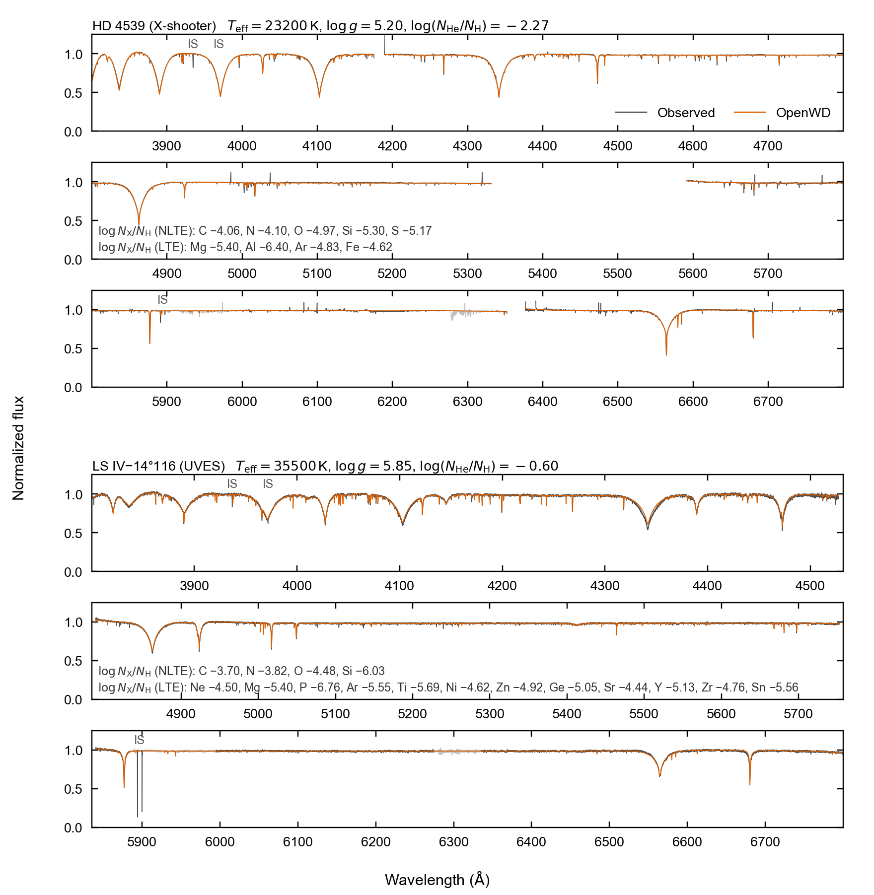

# sdB: hot subdwarf B stars

[Model guide](README.md) · [Getting started](../getting-started.md)

OpenWD computes hybrid LTE/NLTE models of hot subdwarf B (sdB) stars. These
are hydrogen–helium atmospheres at lower gravity than white dwarfs. The method
has three steps:

1. Solve an LTE H/He atmosphere structure.
2. Solve NLTE H/He populations on that fixed structure, and compute the
   spectrum.
3. Optional: add trace metals on the fixed H/He host.

`run_model` with `SdBConfig` does steps 1 and 2. A command-line driver does
step 3. OpenWD does not fit observations. All data are bundled; see
[Getting started](../getting-started.md) for the installation.

## Run a model

```python
from wd_spectra import SdBConfig, run_model

run = run_model(
    SdBConfig(
        effective_temperature=23_200, logg=5.20,
        log_helium_to_hydrogen=-2.27,  # log10 N(He)/N(H)
    ),
    "results/sdb-hd4539",
    require_convergence=True,
)
spectrum = run.spectrum  # vacuum wavelength (Å), surface F_lambda, line-free continuum
```

This model takes tens of minutes on one core. The default spectrum covers
3000–9200 Å in 0.05 Å steps. The continuum column uses the same NLTE
populations with all lines removed. `run.convergence_verified` is `True` only
if the LTE structure is certified and the NLTE populations converge.
The model contains no metals.

## Options

| Option | Default | Effect |
| --- | --- | --- |
| `effective_temperature`, `logg` | 23200 K, 5.2 | Stellar parameters. |
| `log_helium_to_hydrogen` | -2.27 | log10 N(He)/N(H). This is the opposite sign to `DABConfig.log_hydrogen_to_helium`. |
| `quality` | `"standard"` | `"standard"` (40 depths) or `"production"` (80 depths). |
| `hydrogen_levels` | 16 | Explicit H I levels in the NLTE atom. |
| `helium_i_atom` | `"14"` | He I model atom: 14 or 24 terms. |
| `population_maximum_iterations` | 600 | Total population-evaluation budget across initialization and full NLTE. |
| `population_tolerance` | 1e-4 | Largest relative population change at convergence. |

The cold population solve first lets ionization adjust to the continuum
radiation field. It then restores spectral-line extinction, emissivity, and
radiative rates together in stages. The model certifies the populations only
at full line strength, using the requested tolerance and the original NLTE
population residual. The stages share the total iteration budget. The model
metadata records each stage's line strength, work, and residual in
`nlte_population_continuation_stages` and the total work in
`nlte_population_iterations`.

## Add trace metals

The metal driver needs the two research-driver stages as input. The LTE
stage takes every metal of the model, so that metal opacity enters the
structure (metal blanketing). Run these commands from the repository root,
with one thread:

```bash
export OMP_NUM_THREADS=1 OPENBLAS_NUM_THREADS=1
python research/sdb_lte_hhe.py --teff 23200 --logg 5.20 --log-he-h -2.27 \
    --abundance C=-4.06 --abundance N=-4.10 --abundance O=-4.97 \
    --abundance Si=-5.30 --abundance S=-5.17 --abundance Mg=-5.40 \
    --abundance Al=-6.40 --abundance Ar=-4.83 --abundance Fe=-4.62 \
    --output results/sdb/hd4539-lte
python research/sdb_hybrid_nlte.py results/sdb/hd4539-lte \
    --hydrogen-levels 16 --accelerated-lambda \
    --population-iterations 200 200 200 \
    --output results/sdb/hd4539-hybrid
python research/sdb_trace_metals.py results/sdb/hd4539-lte results/sdb/hd4539-hybrid \
    --abundance C=-4.06 --abundance N=-4.10 --abundance O=-4.97 \
    --abundance Si=-5.30 --abundance S=-5.17 \
    --lte-abundance Mg=-5.40 --lte-abundance Al=-6.40 \
    --lte-abundance Ar=-4.83 --lte-abundance Fe=-4.62 \
    --output results/sdb/hd4539-metals
```

- Abundances are log10 N(X)/N(H). `--log-he-h` is log10 N(He)/N(H).
- `sdb_lte_hhe.py --abundance` adds the metals to the LTE structure. This does
  not make the model slower. It heats the line-forming layers by 1–2% and
  lowers the Si II/Si III line ratio by a factor of 1.2–1.3. The metal driver
  stops if the structure has no metals; `--metal-free-structure` allows it.
- `sdb_trace_metals.py --abundance` solves an element in NLTE. C, N, O, Si and
  S are available.
- `--lte-abundance` adds an element as LTE line opacity.
- `--heavy-abundance` adds elements heavier than Zn (for example Ge, Sr, Y,
  Zr, Sn) as LTE line opacity.
- Use a new output directory for each stage.

Each stage writes `spectrum.npz` (`wavelength_vacuum` and surface `flux` in
erg s⁻¹ cm⁻² Å⁻¹) and `run-summary.json`. The drivers save outputs even when a
solve does not converge. Before you use a result, check
`atmosphere_convergence_status` (LTE stage), `populations_converged` (NLTE
stage) and `converged` (metal stage) in each summary.

## Physics

- **Structure.** The LTE atmosphere comes from the [DAB](DAB.md) module. In the
  metal recipe it includes the metals (opacity-sampled lines, bound-free edges
  and their electrons). `run_model` with `SdBConfig` has no metals. The
  structure opacity includes the infrared He I lines of the [DB](DB.md) module
  (8361 Å–7.4 µm). At HD 4539 they change the temperature by less than
  2 × 10⁻⁴.
- **NLTE H/He.** The populations use the [DO/DAO](DO-DAO.md) model atoms,
  extended to 16 explicit H I levels, on the fixed temperature and pressure
  structure. The electron density comes from the LTE H/He EOS. Line rates are
  preconditioned with the diagonal operator of Rybicki & Hummer (1991).
  Helium conservation replaces the rate equation of the most populated helium
  state.
- **Metals (driver).** The fixed-host method of the hot DA/DAO trace metals
  holds the H/He structure and populations fixed. C, N, O, Si and S are solved
  in NLTE with ALL model atoms (van Hoof et al. 2018). CHIANTI collision
  strengths are used for C II–IV and O III (Del Zanna et al. 2021).
  Photoionization of C, N, O, Si and S (all stages below the top one) uses
  the Opacity Project cross sections of the TLUSTY model atoms (Hubeny &
  Lanz 2017), most of them the BSTAR2006 atoms (Lanz & Hubeny 2007). Levels
  without a matching term, mostly Rydberg levels of the large C II and C III
  atoms, use hydrogenic cross sections.
- **LTE metal lines (driver).** Other elements enter as LTE line opacity at the
  host electron density. Sr II–III, Zr III–IV and the N II 3d–4f lines come
  from Kurucz (2011). Ge III and Y III come from Naslim et al. (2011), and Sn IV
  from Biswas et al. (2018). Where laboratory wavelengths are poor, the
  observed values of Dorsch et al. (2020) are used.

## Validation

[](../assets/sdb-paper.pdf)

Optical spectra (gray) and OpenWD models (orange). The top three panels show
X-shooter spectra of the He-poor star HD 4539. Its parameters come from
Schneider et al. (2018) and its metal abundances from Geier (2013). The bottom
three panels show UVES spectra of the He-rich star LS IV−14°116, with the
parameters, abundances and v sin i of Dorsch et al. (2020). The models have
the metal-blanketed LTE structure (`research/sdb_paper_models.sh`). Light gray
marks telluric bands. "IS" marks interstellar Ca II and Na D.

- HD 4539: the H and He lines agree with the data. Most Si II lines are
  about 1.5 times too deep, and Si III, N II, S III and Fe III are too
  shallow. A model 2000 K hotter fits these lines better (see
  [Silicon ionization](#silicon-ionization)).
- LS IV−14°116: the C II and N II lines agree except C II 4267 Å, which is
  too weak. The model cores of Hγ and Hδ are shallower than observed.

### Metal lines

[](../assets/sdb-zoom-lines.pdf)

Two windows of about 100 Å with the same models and normalization as the
figure above, in air wavelengths. For HD 4539, the blue line is the same
model at 25,200 K, the Teff that fits its Si II/Si III balance (see
[Silicon ionization](#silicon-ionization)). Each label names the feature of
the published-Teff model it points to. `research/plot_sdb_zoom_lines.py` matches each absorption of the
model to the lines within 0.3 Å and names the strongest one by an LTE opacity
estimate at Rosseland optical depth 0.3 of the star's structure. A second
species of similar strength is named as a blend.

- LS IV−14°116: the heavy-element lines (Zr IV 4198 Å, Sn IV 4216 Å,
  Ge III 4261 and 4292 Å, Sr III 5023 Å) and the N II lines match the
  observed depths to within about 10%. C II 4267 Å is too weak (core depth
  0.13 against 0.20).
- HD 4539, at the published Teff: the N II lines are 1.5–2 times and
  S III 4253 Å about 2.5 times too shallow, and Ar II 4278 Å is twice too
  deep. At 25,200 K the N II lines reach 80–100% of the observed depths
  (N II 5045 Å about 65%), close to the ±0.16 dex error of the N abundance,
  and Si II 4128 Å matches. NLTE is not the cause of the weak N II lines: it
  deepens them by 5–10% relative to LTE.

### Silicon ionization

[](../assets/sdb-silicon.pdf)

Si II 4128/4131 Å and Si III 4552–4575 Å in HD 4539 (top) and Feige 38
(bottom). X-shooter spectra are gray. All models use the published log g,
He/H and abundances (Geier 2013; for Feige 38, log Si/H = −4.20 from Geier's
Si III lines, while his Si IV lines give −4.85), metals in the LTE structure
(`sdb_lte_hhe.py --abundance`) and the full metal mixture. Orange: the
published Teff (Schneider et al. 2018). Blue: 2000 K (HD 4539) and 1000 K
(Feige 38) hotter. The right panels show the equivalent-width ratio
Si II 4128 Å / Si III 4552 Å against Teff; the gray line is the observed
ratio.

- At the published Teff, the models give too much Si II relative to Si III.
  The 4128/4552 ratio is 0.36 against 0.11 observed (HD 4539) and 0.21
  against 0.15 (Feige 38).
- TLUSTY/SYNSPEC gives the same silicon lines (last figure), so the
  discrepancy is not specific to OpenWD.
- A Teff 1000–2000 K higher brings Si II/Si III into agreement. The OpenWD
  Balmer lines fit as well or better at these temperatures: HD 4539 fits best
  at +1000 K, Feige 38 at +2000 to +3000 K.

[](../assets/sdb-metals-hd4539.pdf)

[](../assets/sdb-metals-feige38.pdf)

Other metal lines at the Teff that fits the silicon ionization (blue), with
the published-Teff model (orange) for reference. The models are the same as
in the figure above.

- HD 4539 at 25,200 K: N II, S III and Fe III are deeper and close to the
  observed depths (core depth of N II 3995 Å: 0.14 against 0.16 observed,
  0.11 at 23,200 K; S III 4254 Å: 0.042 against 0.060, 0.026; Fe III 4165 Å:
  0.054 against 0.058, 0.036). Mg II 4481 Å weakens towards the data.
  C II 4267 Å barely changes and stays slightly too weak.
- Feige 38 at 29,200 K: N II, O II and Fe III barely change, and S III gets
  closer to the data. C II 4267 Å becomes weaker (0.12 against 0.19
  observed; 0.14 at 28,200 K), and Si IV 4089/4116 Å, which matches at the
  published Teff, becomes about 1.5 times too strong.
- In Feige 38 at every Teff, Si III 4552–4575 Å is too weak and
  Si III 4813–4829 Å is 1.3–1.5 times too strong.

The silicon ionization balance therefore favors a higher Teff than the
published H/He value. In HD 4539 the other metal lines agree; in Feige 38
carbon and Si IV do not. Use it as a Teff diagnostic with care.

[](../assets/sdb-silicon-tlusty.pdf)

OpenWD and TLUSTY 208/SYNSPEC at the HD 4539 parameters, with silicon only
(BSTAR2006 Si II–IV atoms in TLUSTY). Solid lines are NLTE and dashed lines
LTE. The TLUSTY NLTE H/He structure agrees with the OpenWD structure to 0.2%
where the lines form. Both codes give the same Si II/Si III ratio (0.37) and
the same Si III 4552 Å equivalent width (30 mÅ against 65 mÅ observed).

## Limitations

- The structure is LTE. Metal blanketing uses the abundances of the model,
  not a scaled solar mixture.
- At the published Teff, Si II is too strong relative to Si III (see
  [Silicon ionization](#silicon-ionization)).
- The LTE structure becomes less accurate above about 40,000 K.
- Radiation pressure and vertical abundance stratification are not included.
- He I lines assume ⁴He.
- The NLTE spectrum does not include the infrared He I lines that the LTE
  structure includes. In the default 3000–9200 Å grid, this omits only
  He I 8362 Å.

See [limitations](../limitations.md) for the shared caveats.

## Tested range

See [tested points](../tested-temperature-ranges.md).
